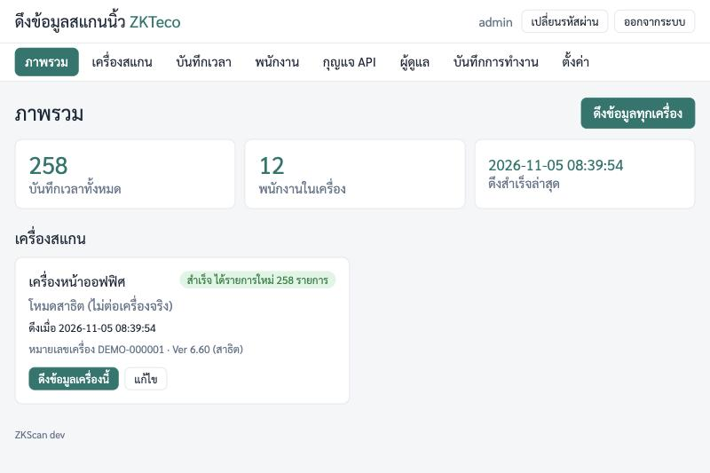

# zkscan

zkscan เป็นบริการบน Linux server ที่ **ดึงบันทึกการสแกนจากเครื่องสแกน ZKTeco เอง** ผ่านวงแลน เก็บไว้ในฐานข้อมูล SQLite ไฟล์เดียว (ไม่เก็บซ้ำ)
ตั้งค่าและดูข้อมูลผ่านหน้าเว็บภาษาไทย (ต้องล็อกอิน) พอร์ต 6565 และเปิด **API** ให้ระบบอื่น เช่น ระบบ HR ดึงต่อด้วยกุญแจ API
ติดตั้งได้ 2 วิธี: เป็นบริการ systemd (`sudo ./install.sh`) หรือ Docker (`docker compose up -d`)



> server ที่ติดตั้ง zkscan ต้องอยู่ในวงแลนเดียวกับเครื่องสแกน (เข้าถึงพอร์ต 4370 ของเครื่องได้โดยตรง)

## ติดตั้งแบบเร็ว (systemd)

ต้องใช้ Linux ที่มี systemd (Ubuntu 22.04/24.04, Debian 12, Rocky/AlmaLinux 9 ฯลฯ) CPU แบบ amd64 หรือ arm64 และต่ออินเทอร์เน็ตได้ตอนติดตั้ง

```bash
git clone https://github.com/elysiacores/zkscan.git
cd zkscan
sudo ./install.sh
```

ตัวติดตั้งจะแสดงที่อยู่เว็บและ **รหัสผ่านชั่วคราวของ admin** ให้จดไว้

## ติดตั้งแบบ Docker

```bash
git clone https://github.com/elysiacores/zkscan.git
cd zkscan
docker compose up -d --build
docker compose exec zkscan zkscan show-initial-password
```

บรรทัดสุดท้ายแสดงรหัสผ่านชั่วคราวของ `admin` (ข้อมูลเก็บใน volume `zkscan-data`)

## เข้าใช้ครั้งแรก

- เปิดเบราว์เซอร์ไปที่ `http://<IP ของ server>:6565`
- ล็อกอินด้วยชื่อผู้ใช้ `admin` และรหัสผ่านชั่วคราวที่ตัวติดตั้งแสดง
- ระบบบังคับตั้งรหัสผ่านใหม่ทันที (อย่างน้อย 8 ตัวอักษร) แล้วไปเพิ่มเครื่องสแกนที่เมนู **เครื่องสแกน**

## เอกสาร

- **[คู่มือติดตั้งและใช้งาน (docs/MANUAL.th.md)](docs/MANUAL.th.md)** สำหรับเจ้าหน้าที่ IT: เตรียมเครื่อง ติดตั้ง ตั้งค่า ใช้งาน สำรองข้อมูล แก้ปัญหา
- **[คู่มือ API (docs/API.th.md)](docs/API.th.md)** สำหรับนักพัฒนาระบบ HR: การยืนยันตัวตน endpoint รูปแบบ JSON ตัวอย่างโค้ด

## ความปลอดภัยที่ต้องทำ

- ใช้ในวงแลนภายในเท่านั้น และเปิดพอร์ต 6565 ให้เฉพาะเครือข่ายสำนักงาน **อย่าเปิดออกอินเทอร์เน็ตโดยตรง**
- เปิด HTTPS (ตั้ง `ZKSCAN_TLS_CERT` และ `ZKSCAN_TLS_KEY`) ไม่เช่นนั้นรหัสผ่านและกุญแจ API จะวิ่งในวงแลนแบบไม่เข้ารหัส
- กุญแจ API แยกต่อระบบ และจำกัด IP ให้เหลือเฉพาะ IP ของ server HR กุญแจเต็มแสดงครั้งเดียว เก็บให้ดี
- ผู้ดูแลทุกคนมีสิทธิ์เท่ากัน จึงมีเท่าที่จำเป็น และเปลี่ยนรหัสผ่านชั่วคราวทันที
- สำรองไฟล์ `zkscan.db` สม่ำเสมอ ไฟล์นี้มีข้อมูลส่วนบุคคลของพนักงาน เก็บในที่ที่เข้าถึงได้เฉพาะผู้เกี่ยวข้อง

## สำหรับนักพัฒนา

ต้องใช้ Go 1.24 ขึ้นไป

```bash
make test      # go test -race ./...
make vet       # go vet ./...
make build     # ไฟล์ dist/zkscan สำหรับเครื่องที่ใช้อยู่
make dist      # dist/zkscan-linux-amd64 และ dist/zkscan-linux-arm64 (CGO_ENABLED=0)
go run ./cmd/zkscan serve --data ./data   # รันบนเครื่องตัวเอง แล้วเปิด http://localhost:6565
```

คำสั่งของโปรแกรม: `zkscan serve | init | reset-password <ชื่อผู้ใช้> | show-initial-password | version`
ตัวเลือก (ใส่หลังชื่อคำสั่ง ค่าจากตัวเลือกชนะค่าจาก env): `--listen` (env `ZKSCAN_LISTEN`, ค่าเริ่มต้น `:6565`), `--data` (env `ZKSCAN_DATA`, ค่าเริ่มต้น `./data`), `--tls-cert` (env `ZKSCAN_TLS_CERT`), `--tls-key` (env `ZKSCAN_TLS_KEY`) สองตัวหลังต้องตั้งคู่กัน

ใบอนุญาต: (ยังไม่ได้กำหนด)
