# คู่มือติดตั้งและใช้งาน zkscan

คู่มือนี้เขียนสำหรับ **เจ้าหน้าที่ IT ประจำสำนักงาน** ที่ไม่ต้องเชี่ยวชาญ Linux ทำตามทีละขั้นก็ติดตั้ง ตั้งค่า และใช้งานได้เอง
ส่วนนักพัฒนาระบบ HR ให้อ่าน [คู่มือ API](API.th.md)

> ข้อความที่อยู่ในเครื่องหมายคำพูด เช่น "ดึงข้อมูลทุกเครื่อง" คือชื่อเมนูหรือปุ่มในหน้าเว็บจริง
> คำสั่งในกล่องสีเทา คัดลอกไปวางในหน้าต่างคำสั่ง (terminal) ของ server ได้เลย

## สารบัญ

1. [ภาพรวม](#1-ภาพรวม)
2. [สิ่งที่ต้องเตรียม](#2-สิ่งที่ต้องเตรียม)
3. [ติดตั้ง วิธีที่ 1 (แนะนำ): บริการ systemd](#3-ติดตั้ง-วิธีที่-1-แนะนำ-บริการ-systemd)
4. [ติดตั้ง วิธีที่ 2: Docker](#4-ติดตั้ง-วิธีที่-2-docker)
5. [เข้าใช้ครั้งแรก](#5-เข้าใช้ครั้งแรก)
6. [เพิ่มเครื่องสแกน](#6-เพิ่มเครื่องสแกน)
7. [ดูบันทึกเวลาและพนักงาน](#7-ดูบันทึกเวลาและพนักงาน)
8. [ตั้งรอบดึงอัตโนมัติ](#8-ตั้งรอบดึงอัตโนมัติ)
9. [ให้ระบบ HR ดึงข้อมูล (กุญแจ API)](#9-ให้ระบบ-hr-ดึงข้อมูล-กุญแจ-api)
10. [ผู้ดูแลหลายคน และการลืมรหัสผ่าน](#10-ผู้ดูแลหลายคน-และการลืมรหัสผ่าน)
11. [บันทึกการทำงาน](#11-บันทึกการทำงาน)
12. [เปิด HTTPS ไฟร์วอลล์ และเปลี่ยนพอร์ต](#12-เปิด-https-ไฟร์วอลล์-และเปลี่ยนพอร์ต)
13. [งานดูแลประจำ](#13-งานดูแลประจำ)
14. [แก้ปัญหาที่พบบ่อย](#14-แก้ปัญหาที่พบบ่อย)
15. [คำศัพท์](#15-คำศัพท์)

---

## 1. ภาพรวม

zkscan คือโปรแกรมที่รันบน Linux server ทำหน้าที่ **ไปดึงบันทึกการสแกนนิ้ว/ใบหน้า/บัตรจากเครื่องสแกน ZKTeco เอง**
เก็บลงฐานข้อมูล แล้วเปิดให้คนดูผ่านหน้าเว็บ และให้ระบบ HR ดึงต่อผ่าน API

```
เครื่องสแกน ZKTeco  (พนักงานสแกน เครื่องเก็บบันทึกไว้)
      │   zkscan ต่อเข้าไปอ่านเองผ่านวงแลน (พอร์ต 4370)
      ▼
zkscan บน server   (เก็บใน SQLite ไฟล์เดียว ไม่เก็บซ้ำ ดึงให้อัตโนมัติทุก 5 นาที)
      │
      ├──▶ หน้าเว็บ  http://<IP server>:6565   (ผู้ดูแลล็อกอินเพื่อตั้งค่า ดูบันทึก ส่งออก CSV)
      │
      └──▶ API       http://<IP server>:6565/api/...   (ระบบ HR ใช้กุญแจ API ดึงข้อมูล)
                ▼
            ระบบ HR
```

สิ่งที่ zkscan **ทำ**: ดึงบันทึกเวลาและรายชื่อพนักงานจากเครื่อง, เก็บไว้ไม่ให้ซ้ำ, แสดงในหน้าเว็บ, ส่งออก CSV, เปิด API
สิ่งที่ zkscan **ไม่ทำ**: คำนวณมาสาย/ขาด/OT, ทำกะงาน, ส่งแจ้งเตือน LINE/อีเมล, แก้ไขหรือลบข้อมูลในเครื่องสแกน
(zkscan อ่านข้อมูลจากเครื่องอย่างเดียว ยกเว้นปุ่ม "ตั้งเวลาเครื่อง" ที่คุณกดเองเพื่อตั้งนาฬิกาเครื่อง)

---

## 2. สิ่งที่ต้องเตรียม

ติ๊กให้ครบก่อนเริ่มติดตั้ง

### 2.1 Server

- [ ] **Linux server ที่ใช้ systemd** เช่น Ubuntu 22.04 / 24.04, Debian 12, Rocky Linux 9, AlmaLinux 9 (ถ้าใช้ Docker ไม่ต้องมี systemd)
- [ ] CPU แบบ **amd64** (เครื่องทั่วไป) หรือ **arm64** (เช่น Raspberry Pi 64 บิต)
- [ ] อยู่ใน **วงแลนเดียวกับเครื่องสแกน** (หรือมี VPN เข้าวงแลนสำนักงาน) server บนคลาวด์ภายนอกจะมองไม่เห็นเครื่องสแกน
- [ ] ต่ออินเทอร์เน็ตได้ **ตอนติดตั้ง** (ตัวติดตั้งจะดาวน์โหลดโปรแกรมช่วยคอมไพล์ Go ประมาณ 70 MB และไลบรารีที่จำเป็น)
      ถ้า server ไม่มีอินเทอร์เน็ต ให้สร้างไฟล์โปรแกรมจากเครื่องอื่นด้วย `make dist` แล้วคัดลอกโฟลเดอร์ `dist/` มาไว้ในโฟลเดอร์ `zkscan` บน server (ดูหัวข้อ 3.5)
- [ ] มีสิทธิ์ **sudo** (ผู้ดูแลระบบของ server)
- [ ] ติดตั้ง `git` แล้ว (ถ้ายังไม่มี: Ubuntu/Debian `sudo apt install -y git` / Rocky,Alma `sudo dnf install -y git`)
- [ ] คอมพิวเตอร์ที่มีเบราว์เซอร์ในวงแลนเดียวกัน ไว้เปิดหน้าเว็บ

### 2.2 ข้อมูลของเครื่องสแกนแต่ละเครื่อง (จดไว้ก่อน)

| ข้อมูล | ค่าปกติ | ใช้ทำอะไร |
|---|---|---|
| **IP** ของเครื่องสแกน | เช่น `192.168.1.201` | บอก zkscan ว่าจะต่อไปที่ไหน |
| **พอร์ต** | `4370` | ค่ามาตรฐานของ ZKTeco |
| **Comm Key** (รหัสเชื่อมต่อ) | `0` ถ้าไม่เคยตั้ง | รหัสตัวเลข 0-999999 ที่เครื่องใช้ยืนยันว่าใครต่อเข้ามา |

**วิธีดูค่าเหล่านี้บนตัวเครื่องสแกน** (ชื่อเมนูต่างกันตามรุ่นและเฟิร์มแวร์ ข้างล่างเป็นรุ่นทั่วไป ถ้าไม่ตรงให้ดูคู่มือของเครื่อง):

1. กดปุ่ม **Menu** บนเครื่อง (ต้องใช้บัญชีผู้ดูแลเครื่อง/Administrator)
2. เข้า **การสื่อสาร / Comm.** (บางรุ่นอยู่ใน System > Communication)
3. **IP**: เข้า **อีเทอร์เน็ต / Ethernet** จะเห็น IP Address, Subnet Mask, Gateway (บางรุ่นมีช่อง Port ตรงนี้ด้วย ปกติ 4370)
4. **Comm Key**: เข้า **ความปลอดภัย / Security** หรือ **PC Connection / การเชื่อมต่อพีซี** จะมีช่อง **Comm Key** (ถ้าเป็น 0 หรือว่าง แปลว่าไม่ได้ตั้ง)

คำแนะนำ: ควรตั้ง IP ของเครื่องสแกนเป็นแบบ **คงที่ (Static)** หรือให้ router จอง IP ให้เครื่องนั้น ไม่เช่นนั้น IP เปลี่ยนแล้ว zkscan จะต่อไม่ติด

### 2.3 เช็กว่า server ต่อถึงเครื่องสแกนได้ (ทำบน server)

เปลี่ยน `192.168.1.201` เป็น IP เครื่องสแกนของคุณ

```bash
ping -c 3 192.168.1.201
nc -vz 192.168.1.201 4370
```

- `ping` ตอบกลับ (มี `time=...ms`) = เครื่องสแกนอยู่ในเครือข่ายและ server เห็น
- `nc` ขึ้นคำว่า `succeeded` (หรือ `open`) = พอร์ต 4370 ต่อได้
- ถ้า `nc` ไม่ขึ้นแต่ `ping` ผ่าน: เครื่องบางรุ่นใช้ UDP ซึ่ง `nc` แบบนี้ทดสอบไม่ได้ ให้ข้ามไปลอง **ทดสอบการเชื่อมต่อ** ในหน้าเว็บแทน
- ถ้า `ping` ไม่ผ่าน: ตรวจสายแลน, IP ที่จดมา, และว่า server กับเครื่องสแกนอยู่วงแลน (VLAN) เดียวกันหรือมีไฟร์วอลล์คั่นหรือไม่ ปัญหานี้ต้องแก้ที่เครือข่ายก่อน

> ถ้าไม่มี `nc`: Ubuntu/Debian `sudo apt install -y netcat-openbsd` / Rocky,Alma `sudo dnf install -y nmap-ncat`

---

## 3. ติดตั้ง วิธีที่ 1 (แนะนำ): บริการ systemd

### 3.1 คำสั่งติดตั้ง

ล็อกอินเข้า server (ด้วย SSH หรือหน้าจอ) แล้วรัน 3 บรรทัดนี้ทีละบรรทัด:

```bash
git clone <ที่อยู่ repo ของ zkscan> zkscan
cd zkscan
sudo ./install.sh
```

(แทน `<ที่อยู่ repo ของ zkscan>` ด้วยที่อยู่ GitHub จริง ที่ผู้เผยแพร่ให้มา)

ตัวติดตั้งทำงานอัตโนมัติ 6 ขั้น ใช้เวลาราว 1-5 นาที (ครั้งแรกนานกว่าเพราะต้องดาวน์โหลดและคอมไพล์) **อย่าเพิ่งปิดหน้าต่าง**
รันซ้ำกี่ครั้งก็ปลอดภัย (ใช้อัปเดตเวอร์ชันได้ด้วย)

### 3.2 สิ่งที่ควรเห็น (ตัวอย่างย่อ)

```
==> ขั้น 1/6  ตรวจระบบและหาไฟล์โปรแกรม
    สถาปัตยกรรม CPU: amd64
    ไม่พบ dist/zkscan-linux-amd64 และไม่มี Go 1.24+ ในเครื่อง — จะดาวน์โหลด Go ทางการมาคอมไพล์ให้อัตโนมัติ
    กำลังดาวน์โหลด Go 1.24.13 สำหรับคอมไพล์ (ประมาณ 70 MB) ... อาจใช้เวลาสักครู่ อย่าเพิ่งกดปิด
    ตรวจไฟล์ถูกต้อง (SHA-256 ตรงกัน)
    คอมไพล์เสร็จ (เวอร์ชัน ...)
    เวอร์ชันที่จะติดตั้ง: zkscan ...

==> ขั้น 2/6  เตรียมผู้ใช้ระบบ โฟลเดอร์ข้อมูล และไฟล์ตั้งค่า
    สร้างผู้ใช้ระบบ 'zkscan' แล้ว (ล็อกอินไม่ได้)
    โฟลเดอร์ข้อมูล: /var/lib/zkscan (ข้อมูลทั้งหมดอยู่ที่นี่ รวมถึงไฟล์ zkscan.db)
    สร้างไฟล์ตั้งค่า /etc/zkscan/zkscan.env แล้ว

==> ขั้น 3/6  ติดตั้งไฟล์โปรแกรมไปที่ /usr/local/bin/zkscan
==> ขั้น 4/6  เตรียมฐานข้อมูลและบัญชีผู้ดูแล (zkscan init)
    รหัสผ่านชั่วคราวของ admin: XXXXXXXXXXXX
    ต้องเปลี่ยนรหัสผ่านนี้ทันทีเมื่อเข้าสู่ระบบครั้งแรก
==> ขั้น 5/6  ติดตั้งบริการ systemd และเริ่มทำงาน
    เปิดบริการแล้ว และจะเริ่มเองทุกครั้งที่เปิดเครื่อง

==> ขั้น 6/6  เสร็จเรียบร้อย
==============================================================
 ติดตั้ง zkscan สำเร็จ (zkscan ...)
==============================================================

เปิดเว็บเพื่อตั้งค่าได้ที่ (เปิดจากคอมพิวเตอร์เครื่องไหนก็ได้ในวงแลนเดียวกัน):
    http://192.168.1.50:6565

ล็อกอินครั้งแรก:  ชื่อผู้ใช้ admin
  รหัสผ่านชั่วคราวของ admin: XXXXXXXXXXXX
  (จดไว้ แล้วระบบจะบังคับให้เปลี่ยนรหัสผ่านทันทีที่เข้าครั้งแรก)
```

(`XXXXXXXXXXXX` คือรหัสจริงที่ระบบสุ่มให้ ในคู่มือนี้ปิดไว้)

### 3.3 สิ่งที่ต้องจดไว้ตอนจบ

1. **ที่อยู่เว็บ** บรรทัดที่ขึ้นต้น `http://...:6565` (ถ้าเครื่องมีหลาย IP จะแสดงหลายบรรทัด ให้เลือกอันที่คอมพิวเตอร์ของคุณเข้าถึงได้)
2. **ชื่อผู้ใช้** `admin`
3. **รหัสผ่านชั่วคราว** (หลังบรรทัด `รหัสผ่านชั่วคราวของ admin:`)

ลืมจดรหัสชั่วคราว? ดูอีกครั้งได้ **จนกว่า admin จะเปลี่ยนรหัสผ่านแล้ว**:

```bash
sudo -u zkscan env ZKSCAN_DATA=/var/lib/zkscan /usr/local/bin/zkscan show-initial-password
```

ถ้าเปลี่ยนรหัสไปแล้วและลืม ดูหัวข้อ [10.3 ลืมรหัสผ่าน](#103-ลืมรหัสผ่าน)

### 3.4 ถ้าติดตั้งไม่สำเร็จ

ตัวติดตั้งหยุดพร้อมข้อความ `[ผิดพลาด] ...` แก้ตามตารางแล้ว **รันคำสั่งเดิมซ้ำได้อย่างปลอดภัย**

| ข้อความที่เห็น | สาเหตุ | วิธีแก้ |
|---|---|---|
| `ต้องรันด้วยสิทธิ์ผู้ดูแลระบบ (root)` | ลืมใส่ `sudo` | พิมพ์ `sudo ./install.sh` |
| `bash: ./install.sh: Permission denied` (ไม่ใช่ข้อความของตัวติดตั้ง) | ไฟล์ไม่มีสิทธิ์รัน (เช่น ดาวน์โหลดเป็น zip) | `sudo bash ./install.sh` |
| `สคริปต์นี้ใช้ได้กับ Linux เท่านั้น` | รันบน macOS/Windows | ใช้ Linux server หรือใช้ Docker (หัวข้อ 4) |
| `เครื่องนี้ไม่ได้ใช้ systemd` | ระบบไม่มี systemd (เช่น คอนเทนเนอร์, WSL เก่า) | ใช้ Docker (หัวข้อ 4) |
| `ไม่รองรับสถาปัตยกรรม CPU แบบ ...` | CPU ไม่ใช่ amd64/arm64 | ใช้ Docker |
| `ไม่พบคำสั่ง tar` / `ไม่พบคำสั่ง sha256sum` | ขาดเครื่องมือพื้นฐาน | ติดตั้ง `tar` และ `coreutils` (Ubuntu/Debian: `sudo apt install -y tar coreutils` / Rocky,Alma: `sudo dnf install -y tar coreutils`) แล้วรันใหม่ |
| `ไม่พบทั้ง curl และ wget` | ไม่มีเครื่องมือดาวน์โหลด | ติดตั้ง `curl` (`sudo apt install -y curl` หรือ `sudo dnf install -y curl`) แล้วรันใหม่ |
| `ดาวน์โหลด Go ไม่สำเร็จ ...` | server ออกอินเทอร์เน็ตไม่ได้ หรือต้องผ่าน proxy | ตรวจอินเทอร์เน็ต ถ้าใช้ proxy ให้ตั้ง `export https_proxy=http://<proxy>:<พอร์ต>` แล้วรัน `sudo -E ./install.sh` (`-E` ให้ sudo ส่งค่า proxy ต่อ) หรือใช้ Docker หรือใช้โฟลเดอร์ `dist/` (3.5) |
| `ไฟล์ Go ที่ดาวน์โหลดมาไม่ตรงกับค่า SHA-256 ...` | ไฟล์โหลดไม่ครบ หรือถูกแก้ไขระหว่างทาง (ตัวติดตั้งหยุดเพื่อความปลอดภัย) | รันใหม่ ถ้ายังเป็นอีก อย่าฝืน ให้ใช้เครือข่ายอื่น หรือใช้ Docker / `dist/` |
| `แตกไฟล์ Go ไม่สำเร็จ (ดิสก์เต็มหรือไฟล์เสีย?)` | พื้นที่ดิสก์ไม่พอ | เช็ก `df -h` เคลียร์พื้นที่ แล้วรันใหม่ |
| `คอมไพล์ไม่สำเร็จ ...` | โหลดไลบรารีไม่ได้ (อินเทอร์เน็ต/proxy) หรือดิสก์เต็ม | อ่านข้อความเหนือบรรทัดนี้ ตรวจอินเทอร์เน็ต/proxy แล้วรันใหม่ |
| `ไม่พบไฟล์โปรแกรมสำเร็จรูป ... (และสั่งไม่ให้ดาวน์โหลดด้วย --no-download)` | คุณใส่ `--no-download` แต่ไม่มี `dist/` และไม่มี Go 1.24+ | รันใหม่โดยไม่ใส่ `--no-download` หรือใช้ `dist/` หรือติดตั้ง Go 1.24+ |
| `ไฟล์โปรแกรมที่เตรียมไว้รันไม่ได้บนเครื่องนี้` | โฟลเดอร์ `dist/` เป็นของสถาปัตยกรรมอื่น หรือไฟล์เสีย | ลบโฟลเดอร์ `dist/` (`rm -rf dist`) แล้วรันใหม่ หรือสร้างใหม่ด้วย `make dist` |
| `ไม่พบคำสั่ง useradd ...` | ระบบไม่มีเครื่องมือสร้างผู้ใช้ | สร้างผู้ใช้ระบบชื่อ `zkscan` เอง แล้วรันใหม่ |
| `ไม่พบคำสั่ง runuser หรือ sudo ...` | ขาดเครื่องมือรันในนามผู้ใช้ `zkscan` | ติดตั้ง `sudo` หรือ `util-linux` แล้วรันใหม่ |
| `คำสั่ง zkscan init ล้มเหลว` | ดิสก์เต็ม หรือสิทธิ์โฟลเดอร์ `/var/lib/zkscan` ผิด | เช็ก `df -h` และ `ls -ld /var/lib/zkscan` (เจ้าของต้องเป็น `zkscan`) |
| `[คำเตือน] บริการยังไม่ขึ้นสถานะทำงาน` | โปรแกรมเริ่มไม่ขึ้น มักเพราะ **พอร์ต 6565 ถูกโปรแกรมอื่นใช้อยู่** | `sudo journalctl -u zkscan -n 50 --no-pager` ดูสาเหตุ ถ้าพอร์ตชน ให้เปลี่ยนพอร์ตตามหัวข้อ 12.3 |
| `ไม่รู้จักตัวเลือก '...'` | พิมพ์ตัวเลือกผิด | ตัวเลือกที่มี: `--no-download`, `-h` |

### 3.5 ติดตั้งเมื่อ server ไม่มีอินเทอร์เน็ต (ใช้โฟลเดอร์ dist/)

บนคอมพิวเตอร์เครื่องอื่นที่มี Go 1.24 ขึ้นไป และอินเทอร์เน็ต:

```bash
git clone <ที่อยู่ repo ของ zkscan> zkscan
cd zkscan
make dist
```

จะได้ไฟล์ `dist/zkscan-linux-amd64` และ `dist/zkscan-linux-arm64` ให้คัดลอกโฟลเดอร์ `zkscan` ทั้งโฟลเดอร์ (รวม `dist/`) ไปไว้บน server
แล้วรัน `sudo ./install.sh` บน server ตัวติดตั้งจะพบ `dist/` และใช้ไฟล์นั้นเลย ไม่ต้องดาวน์โหลดอะไร
(ถ้าเครื่องไม่มี Go และไม่ต้องการให้ตัวติดตั้งดาวน์โหลด Go ให้ใส่ `--no-download`: `sudo ./install.sh --no-download`)

### 3.6 ตรวจว่าบริการทำงาน

```bash
sudo systemctl status zkscan
```

ต้องเห็น `active (running)` (กด `q` เพื่อออก) จากนั้นเปิดเบราว์เซอร์ไปที่ที่อยู่เว็บที่จดไว้ ถ้าเปิดไม่ได้ ดูหัวข้อ 12.2 (ไฟร์วอลล์)

---

## 4. ติดตั้ง วิธีที่ 2: Docker

เหมาะกับ server ที่ไม่มี systemd หรือที่ใช้ Docker อยู่แล้ว ต้องติดตั้ง Docker และ Docker Compose (คำสั่ง `docker compose`) ไว้ก่อน และต่ออินเทอร์เน็ตได้ตอน build

```bash
git clone <ที่อยู่ repo ของ zkscan> zkscan
cd zkscan
docker compose up -d --build
docker compose exec zkscan zkscan show-initial-password
```

- คำสั่งที่ 3 สร้างและเปิดคอนเทนเนอร์ (ครั้งแรกใช้เวลาสักครู่)
- คำสั่งที่ 4 แสดง `รหัสผ่านชั่วคราวของ admin: ...` **จดไว้** (ใช้ได้จนกว่า admin จะเปลี่ยนรหัส) ถ้าคำสั่งนี้ขึ้นว่าหาไม่พบ รอสัก 5-10 วินาทีให้คอนเทนเนอร์เริ่มก่อน แล้วลองใหม่
  หรือดูจาก `docker compose logs zkscan`
- เปิดเว็บที่ `http://<IP ของเครื่องที่รัน Docker>:6565`

ข้อมูลทั้งหมดเก็บใน **volume ชื่อ `zkscan-data`** (ไม่หายเมื่อหยุดหรือสร้างคอนเทนเนอร์ใหม่ จะหายก็ต่อเมื่อสั่ง `docker compose down -v`)

**เรื่องเขตเวลา:** `docker-compose.yml` ตั้ง `TZ=Asia/Bangkok` ไว้แล้ว (โปรแกรมฝังข้อมูลเขตเวลาไว้ในตัว ใช้ได้แม้ image ไม่มี tzdata)
ถ้าต้องการเขตเวลาอื่น: `ZKSCAN_TZ=Asia/Tokyo docker compose up -d`
เวลาลงสแกนในบันทึก **ใช้ตามนาฬิกาของเครื่องสแกน** ส่วนเวลาที่ server เป็นผู้บันทึก (เช่น เวลาดึงล่าสุด, บันทึกการทำงาน) ใช้ตามเขตเวลานี้

คอนเทนเนอร์ต่อออกไปหาเครื่องสแกนในวงแลนที่เครื่อง Docker host ต่ออยู่ได้ตามปกติ

คำสั่งที่ใช้บ่อย (รันในโฟลเดอร์ `zkscan`):

```bash
docker compose ps                  # ดูสถานะ
docker compose logs -f zkscan      # ดู log สด ๆ (กด Ctrl+C เพื่อออก)
docker compose restart zkscan      # รีสตาร์ท
docker compose down                # หยุดและลบคอนเทนเนอร์ (ข้อมูลยังอยู่)
```

---

## 5. เข้าใช้ครั้งแรก

### 5.1 ล็อกอิน

1. เปิดเบราว์เซอร์ไปที่ `http://<IP ของ server>:6565`
2. จะเห็นหน้า **เข้าสู่ระบบ**
3. ช่อง **ชื่อผู้ใช้** พิมพ์ `admin` ช่อง **รหัสผ่าน** พิมพ์รหัสผ่านชั่วคราวที่จดไว้ แล้วกด **เข้าสู่ระบบ**

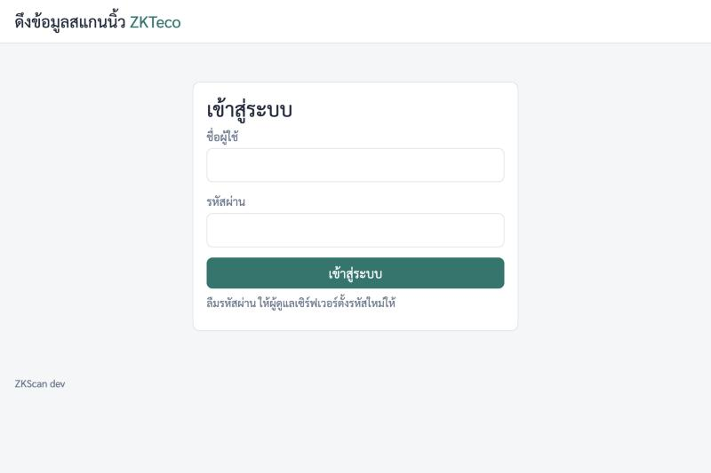
*รูปที่ 1: หน้าเข้าสู่ระบบ*

- ถ้าพิมพ์ผิดจะขึ้น "ชื่อผู้ใช้หรือรหัสผ่านไม่ถูกต้อง" ถ้าผิดหลายครั้งติดกัน (ครบ 5 ครั้ง) ระบบจะล็อกชั่วคราว 15 นาที (ขึ้นว่า "ใส่รหัสผิดหลายครั้งเกินไป ลองใหม่ใน 15 นาที")
- การล็อกอินหมดอายุเองหลังผ่านไป 12 ชั่วโมง ต้องล็อกอินใหม่

### 5.2 บังคับเปลี่ยนรหัสผ่าน

เข้าครั้งแรก (หรือหลังถูกรีเซ็ตรหัส) ระบบจะพาไปหน้า **เปลี่ยนรหัสผ่าน** ทันที ใช้งานอย่างอื่นไม่ได้จนกว่าจะเปลี่ยน

1. ช่อง **รหัสผ่านเดิม** ใส่รหัสชั่วคราว
2. ช่อง **รหัสผ่านใหม่** และ **ยืนยันรหัสผ่านใหม่** ใส่รหัสใหม่ที่คุณตั้ง
3. กด **บันทึกรหัสผ่านใหม่**

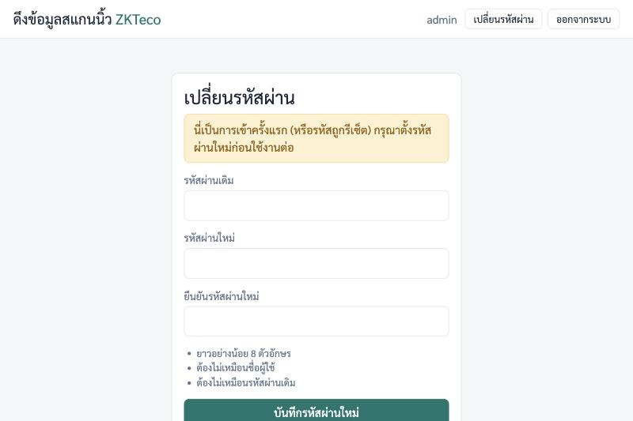
*รูปที่ 2: หน้าเปลี่ยนรหัสผ่าน (ขึ้นแถบเหลืองเมื่อเป็นการเข้าครั้งแรก)*

กติการหัสผ่านใหม่:

- ยาวอย่างน้อย **8 ตัวอักษร**
- ต้อง **ไม่เหมือนชื่อผู้ใช้** (เช่น ชื่อผู้ใช้ `admin` ห้ามตั้งรหัสเป็น `admin`)
- ต้อง **ไม่เหมือนรหัสผ่านเดิม**
- ยาวไม่เกิน 72 ไบต์ (ภาษาอังกฤษ/ตัวเลข = 1 ไบต์ต่อตัว ภาษาไทย = 3 ไบต์ต่อตัว) แนะนำให้ใช้อังกฤษผสมตัวเลข
- ช่องรหัสใหม่ทั้งสองต้องตรงกัน ไม่งั้นขึ้น "รหัสผ่านใหม่ทั้งสองช่องไม่ตรงกัน"

### 5.3 หน้าภาพรวม

เมื่อเปลี่ยนรหัสสำเร็จ จะเข้าหน้า **ภาพรวม** (ขึ้นแถบเขียว "เปลี่ยนรหัสผ่านเรียบร้อยแล้ว")

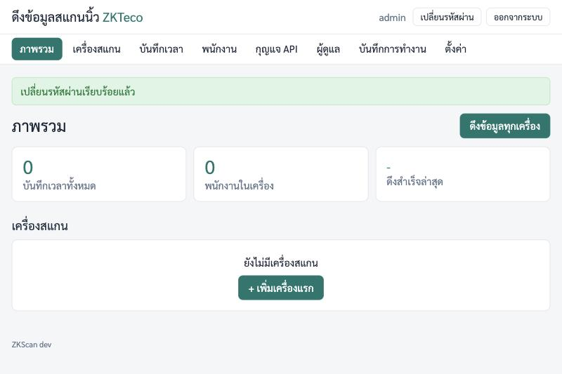
*รูปที่ 3: หน้าภาพรวมตอนเริ่มต้น ยังไม่มีเครื่องสแกน*

แถบเมนูด้านบนมี 8 เมนู: **ภาพรวม**, **เครื่องสแกน**, **บันทึกเวลา**, **พนักงาน**, **กุญแจ API**, **ผู้ดูแล**, **บันทึกการทำงาน**, **ตั้งค่า**
มุมขวาบนมีปุ่ม **เปลี่ยนรหัสผ่าน** และ **ออกจากระบบ**

---

## 6. เพิ่มเครื่องสแกน

### 6.1 กรอกฟอร์ม

1. เมนู **เครื่องสแกน** > ปุ่ม **+ เพิ่มเครื่อง** (หรือจากหน้าภาพรวมกด **+ เพิ่มเครื่องแรก**)
2. กรอกช่องต่าง ๆ ตามตาราง แล้วกด **บันทึก**

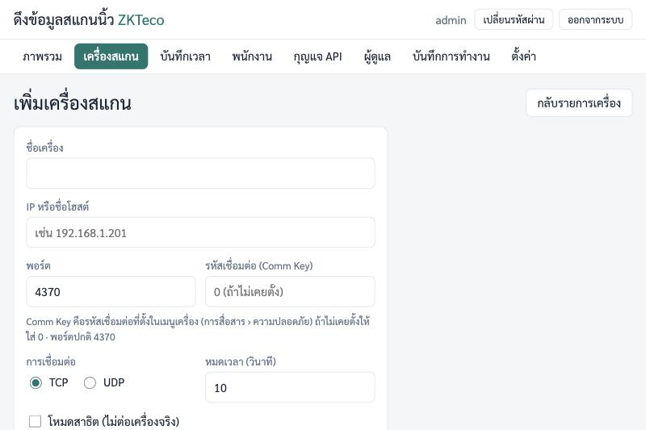
*รูปที่ 4: ฟอร์มเพิ่มเครื่องสแกน*

| ช่อง | กรอกอะไร | ค่าเริ่มต้น / ข้อจำกัด |
|---|---|---|
| **ชื่อเครื่อง** | ชื่อที่ตั้งเองให้จำง่าย เช่น "เครื่องหน้าออฟฟิศ" | ห้ามซ้ำกับเครื่องอื่น ไม่เกิน 100 ตัวอักษร (ชื่อนี้จะไปปรากฏใน API และไฟล์ CSV ด้วย อย่าเปลี่ยนบ่อย) |
| **IP หรือชื่อโฮสต์** | IP ของเครื่องสแกน เช่น `192.168.1.201` | ใช้ได้เฉพาะตัวอักษรอังกฤษ ตัวเลข จุด และขีดกลาง |
| **พอร์ต** | พอร์ตของเครื่องสแกน | `4370` (1-65535) |
| **รหัสเชื่อมต่อ (Comm Key)** | Comm Key ของเครื่อง | ช่องธรรมดา (เห็นตัวเลข) ตอนเพิ่มเครื่องจะว่างและมีข้อความจาง "0 (ถ้าไม่เคยตั้ง)" ไม่บังคับกรอก **เว้นว่าง = 0** (ตัวเลข 0-999999) |
| **การเชื่อมต่อ** | ปุ่มเลือก **TCP** หรือ **UDP** | **TCP** (ใช้ TCP ก่อน เปลี่ยนเป็น UDP เมื่อ TCP ต่อไม่ได้) |
| **หมดเวลา (วินาที)** | รอเครื่องตอบนานเท่าไรก่อนยอมแพ้ | `10` (1-120) ถ้าเครือข่ายช้าหรือผ่าน VPN ให้เพิ่ม |
| **โหมดสาธิต (ไม่ต่อเครื่องจริง)** | ติ๊กเพื่อใช้เครื่องจำลอง | ปิด |
| **เปิดใช้งาน (ดึงข้อมูลตามรอบอัตโนมัติ)** | ติ๊กไว้เพื่อให้ดึงอัตโนมัติ | เปิด |

**โหมดสาธิต:** ถ้ายังไม่มีเครื่องจริงให้ลอง ติ๊ก **โหมดสาธิต (ไม่ต่อเครื่องจริง)** แล้วบันทึก
ระบบจะสร้างข้อมูลจำลอง (พนักงาน 12 คน และบันทึกเวลาตัวอย่างย้อนหลัง 14 วัน) โดยไม่ใช้เครือข่าย ใช้ลองกดดูทุกหน้าและลองเรียก API ได้
เมื่อจะใช้งานจริง ให้ลบเครื่องสาธิตทิ้ง (ปุ่ม **ลบเครื่องนี้** ในหน้าแก้ไข) แล้วเพิ่มเครื่องจริง ไม่งั้นข้อมูลจำลองจะปนกับข้อมูลจริง

ถ้ากรอกผิด จะขึ้นแถบแดง "กรอกข้อมูลไม่ถูกต้อง กรุณาแก้ตามข้อความสีแดงด้านล่าง" และข้อความใต้ช่องที่ผิด เช่น "มีเครื่องชื่อนี้อยู่แล้ว ใช้ชื่ออื่น" แก้แล้วกด **บันทึก** ใหม่

### 6.2 รายการเครื่อง

บันทึกแล้วจะกลับมาหน้า **เครื่องสแกน** ขึ้นแถบเขียว `เพิ่มเครื่อง “...” เรียบร้อยแล้ว`

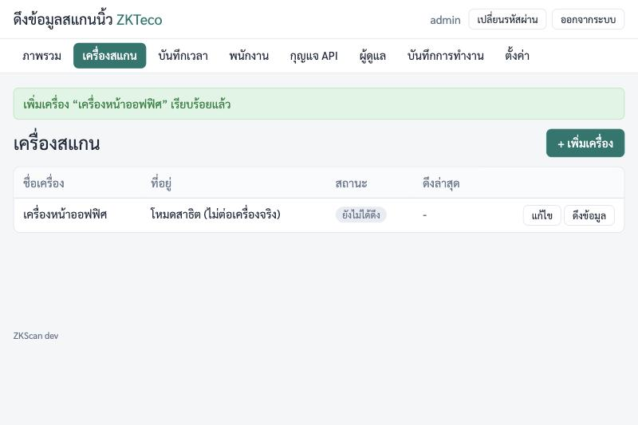
*รูปที่ 5: รายการเครื่องสแกน (ตัวอย่างนี้เป็นเครื่องสาธิต)*

คอลัมน์ **สถานะ** มี 4 แบบ: **ยังไม่ได้ดึง** (เพิ่งเพิ่ม), **ปกติ** (ดึงครั้งล่าสุดสำเร็จ), **ผิดพลาด** (ครั้งล่าสุดไม่สำเร็จ), **ปิดใช้งาน** (ไม่ได้ติ๊ก "เปิดใช้งาน")
ปุ่มท้ายแถว: **แก้ไข** และ **ดึงข้อมูล** (ดึงเครื่องนั้นเดี๋ยวนี้)

### 6.3 หน้าแก้ไขเครื่อง

กด **แก้ไข** จะเข้าหน้า **แก้ไขเครื่องสแกน** ฟอร์มเหมือนเดิม และมีกล่อง **ทำงานกับเครื่องนี้** ทางขวา

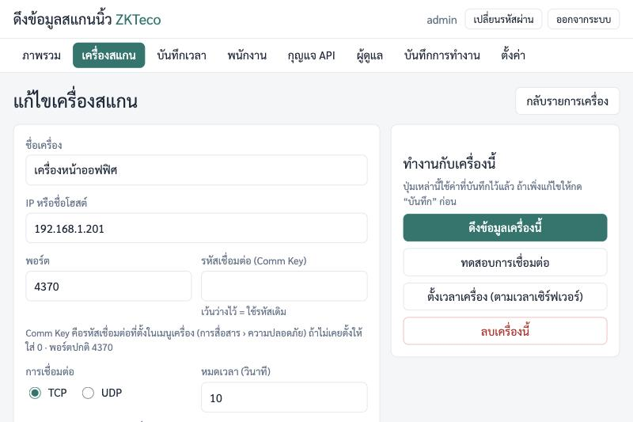
*รูปที่ 6: หน้าแก้ไขเครื่องสแกน*

> สำคัญ: ปุ่มในกล่อง "ทำงานกับเครื่องนี้" ใช้ค่าที่ **บันทึกไว้แล้ว** ถ้าเพิ่งแก้ฟอร์ม ให้กด **บันทึก** ก่อนทุกครั้ง
> และปุ่ม **ทดสอบการเชื่อมต่อ** มีเฉพาะในหน้าแก้ไข ตอนเพิ่มเครื่องใหม่ให้บันทึกก่อน แล้วกลับมากด **แก้ไข**

| ปุ่ม | ทำอะไร |
|---|---|
| **ดึงข้อมูลเครื่องนี้** | ดึงบันทึกเวลาและรายชื่อพนักงานจากเครื่องนี้เดี๋ยวนี้ |
| **ทดสอบการเชื่อมต่อ** | ลองต่อเครื่องและอ่านข้อมูลเครื่องมาแสดง ไม่เก็บบันทึกเวลา |
| **ตั้งเวลาเครื่อง (ตามเวลาเซิร์ฟเวอร์)** | ตั้งนาฬิกาของเครื่องสแกนให้ตรงกับเวลาของ server (ถามยืนยันก่อน) ใช้เมื่อเวลาในเครื่องสแกนเพี้ยน |
| **ลบเครื่องนี้** | ลบเครื่องออกจากระบบ (ถามยืนยันก่อน) **บันทึกเวลาที่ดึงมาแล้วยังอยู่** |

ช่อง **รหัสเชื่อมต่อ (Comm Key)** ในหน้าแก้ไขเป็นช่องรหัส (แสดงเป็นจุด) และว่างเสมอ (ระบบไม่แสดงรหัสที่เก็บไว้) **เว้นว่างไว้ = ใช้รหัสเดิม** (ต่างจากหน้าเพิ่มเครื่องที่เว้นว่าง = 0) ใส่ใหม่เฉพาะเมื่อจะเปลี่ยน

### 6.4 ทดสอบการเชื่อมต่อ

ในหน้าแก้ไข กด **ทดสอบการเชื่อมต่อ** (ปุ่มจะเปลี่ยนเป็น "กำลังทดสอบ…" รอสักครู่ ถ้าเครื่องไม่ตอบอาจรอจนครบเวลาหมดเวลา)

**ถ้าสำเร็จ** จะเห็นแถบเขียว "เชื่อมต่อเครื่องได้สำเร็จ" พร้อมข้อมูลเครื่อง: หมายเลขเครื่อง, เฟิร์มแวร์, รุ่น, ชื่อในตัวเครื่อง, จำนวนผู้ใช้, จำนวนบันทึก, เวลาในเครื่อง

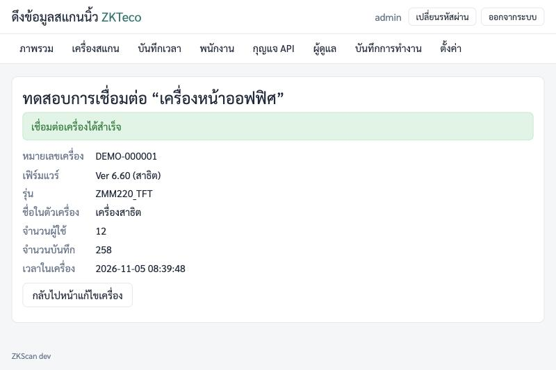
*รูปที่ 7: ทดสอบการเชื่อมต่อสำเร็จ (ตัวอย่างนี้เป็นเครื่องสาธิต)*

ตรวจ **เวลาในเครื่อง** ว่าตรงกับเวลาจริงไหม ถ้าเพี้ยน ให้กด **ตั้งเวลาเครื่อง (ตามเวลาเซิร์ฟเวอร์)** (และตรวจว่านาฬิกาของ server ถูกต้องก่อน)

**ถ้าไม่สำเร็จ** จะเห็นแถบแดง บรรทัดแรกคือสิ่งที่เกิดขึ้น บรรทัดที่สองคือคำแนะนำภาษาไทย

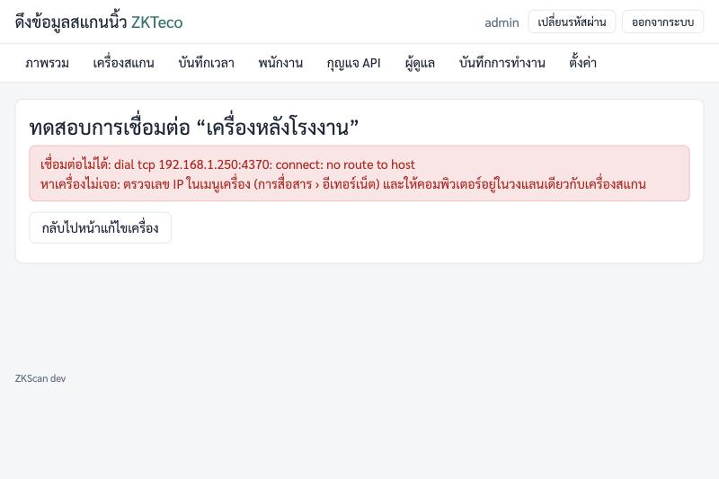
*รูปที่ 8: ทดสอบไม่สำเร็จ พร้อมคำแนะนำ (ตัวอย่างนี้ IP ไม่มีเครื่องอยู่จริง)*

#### ข้อความที่เห็น และต้องทำอย่างไร

| ข้อความที่เห็น | แปลว่า | ทำอย่างไร |
|---|---|---|
| **หาเครื่องไม่เจอ:** ตรวจเลข IP ในเมนูเครื่อง (การสื่อสาร › อีเทอร์เน็ต) และให้คอมพิวเตอร์อยู่ในวงแลนเดียวกับเครื่องสแกน (บรรทัดบนมักมี `no route to host`, `network is unreachable` หรือ `lookup ... no such host`) | server ไม่รู้ทางไปหา IP นั้น | 1) ตรวจ IP ที่กรอกว่าตรงกับในเมนูเครื่อง 2) `ping <IP>` จาก server 3) ตรวจว่า server กับเครื่องสแกนอยู่วงแลนเดียวกัน (ไม่มี VLAN/ไฟร์วอลล์คั่น) 4) ถ้าใช้ชื่อโฮสต์ ให้ลองเปลี่ยนเป็น IP |
| **เครื่องปฏิเสธการเชื่อมต่อ:** ตรวจว่าพอร์ตถูกต้อง (ปกติคือ 4370) และในเมนูเครื่องเปิดการเชื่อมต่อผ่านเครือข่ายไว้ (บรรทัดบนมักมี `connection refused`) | เครื่องสแกนเจอ แต่ไม่ยอมรับที่พอร์ตนี้ | 1) ตรวจพอร์ตในเมนูเครื่อง (ปกติ 4370) 2) ลองสลับเป็น **UDP** แล้วบันทึกและทดสอบใหม่ 3) ตรวจว่าเมนูเครื่องเปิดการสื่อสารผ่านเครือข่ายไว้ 4) ลองรีสตาร์ทเครื่องสแกน |
| **เครื่องไม่ตอบ:** ตรวจเลข IP, สายแลน และพอร์ต (ปกติ 4370) ถ้ายังไม่ได้ลองเปลี่ยนการเชื่อมต่อเป็น UDP หรือเพิ่มเวลาหมดเวลา (บรรทัดบน: `เครื่องไม่ตอบสนอง (หมดเวลา)`) | ส่งคำขอไปแล้วเงียบ | 1) ตรวจสายแลนและไฟเครื่อง 2) `ping <IP>` 3) สลับ TCP/UDP 4) เพิ่ม **หมดเวลา (วินาที)** เป็น 30-60 5) ตรวจไฟร์วอลล์ระหว่าง server กับเครื่องสแกน (ต้องผ่านพอร์ต 4370) |
| **รหัสเชื่อมต่อไม่ตรง:** ใส่ Comm Key ให้ตรงกับในเมนูเครื่อง (การสื่อสาร › ความปลอดภัย) ถ้าเครื่องไม่ได้ตั้งไว้ให้ใส่ 0 (บรรทัดบน: `รหัสเชื่อมต่อ (Comm Key) ไม่ถูกต้อง`) | Comm Key ผิด | ดู Comm Key บนเครื่องอีกครั้ง (หัวข้อ 2.2) แล้วใส่ในช่อง **รหัสเชื่อมต่อ (Comm Key)** ของหน้าแก้ไข กด **บันทึก** แล้วทดสอบใหม่ ถ้าเครื่องไม่ได้ตั้ง ใส่ `0` |
| **เครื่องตอบกลับในรูปแบบที่ไม่รู้จัก:** ลองเปลี่ยน TCP/UDP แล้วลองใหม่ ถ้ายังไม่ได้ ส่งข้อความผิดพลาดนี้และรุ่นเครื่องมาให้ผู้พัฒนา (บรรทัดบน: `ข้อมูลจากเครื่องผิดรูปแบบ: ...`) | เครื่องตอบมาแต่โปรแกรมอ่านไม่เข้าใจ (อาจเป็นรุ่นที่ยังไม่รองรับ) | สลับ TCP/UDP ถ้ายังไม่ได้ จดข้อความแดงทั้งหมดและรุ่นเครื่อง แจ้งผู้พัฒนา |
| **เชื่อมต่อไม่ได้:** ตรวจ IP, พอร์ต และสายแลน แล้วกด “ทดสอบการเชื่อมต่อ” อีกครั้ง | ต่อไม่ติดด้วยสาเหตุอื่น (ดูรายละเอียดในบรรทัดบน) | ตรวจ IP, พอร์ต, สายแลน ตามข้อความ แล้วทดสอบใหม่ |
| **ทำงานกับเครื่องไม่สำเร็จ** / ลองใหม่อีกครั้ง ถ้ายังไม่ได้ให้แจ้งผู้ดูแลระบบ | ข้อผิดพลาดทั่วไป | ลองใหม่ แล้วดู "บันทึกการทำงาน" (หัวข้อ 11) |

หมายเหตุ: ข้อความบรรทัดบนส่วนที่เป็นภาษาอังกฤษ (เช่น `dial tcp 192.168.1.250:4370: connect: no route to host`) เป็นรายละเอียดทางเทคนิคจากระบบ ใช้ส่งต่อให้ผู้ช่วยเหลือได้

### 6.5 ดึงข้อมูลครั้งแรก

เมื่อทดสอบผ่านแล้ว ให้ดึงข้อมูล:

- ที่หน้าแก้ไข: **ดึงข้อมูลเครื่องนี้** หรือที่หน้า **ภาพรวม**: **ดึงข้อมูลทุกเครื่อง**
- ปุ่มจะขึ้น "กำลังดึงข้อมูล…" รอจนเสร็จ ครั้งแรกอาจนานหน่อยถ้าเครื่องมีบันทึกสะสมมาก อย่ากดซ้ำ
- ระหว่างดึง เครื่องสแกนอาจหยุดรับการสแกนช่วงสั้น ๆ จึงควรดึงครั้งแรกในช่วงที่ไม่มีคนสแกนหนาแน่น

จะได้หน้าผลลัพธ์: แถบเขียว "สำเร็จ ... จาก ... เครื่อง ได้รายการใหม่ ... รายการ" พร้อมตารางผลรายเครื่อง

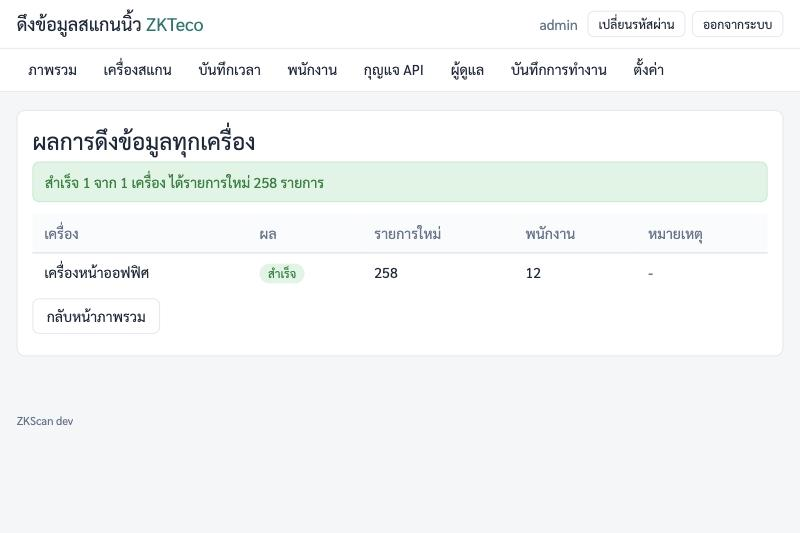
*รูปที่ 9: ผลการดึงข้อมูล (สำเร็จ 1 จาก 1 เครื่อง ได้รายการใหม่ 258 รายการ)*

ตารางผลมีคอลัมน์ **เครื่อง**, **ผล** (สำเร็จ/ไม่สำเร็จ), **รายการใหม่**, **พนักงาน**, **หมายเหตุ** (ถ้าไม่สำเร็จ จะมีข้อความผิดพลาดและคำแนะนำแบบในหัวข้อ 6.4)
กด **กลับหน้าภาพรวม**

ถ้ามีการดึงอยู่แล้ว (เช่น รอบอัตโนมัติกำลังทำงาน) จะขึ้น "กำลังดึงข้อมูลอยู่ รอสักครู่แล้วลองใหม่" ให้รอแล้วกดใหม่

### 6.6 หน้าภาพรวมหลังมีข้อมูล

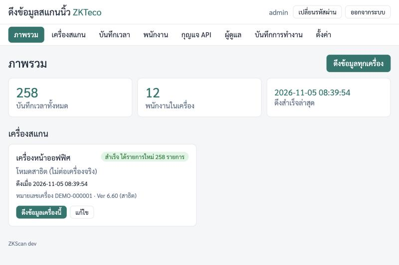
*รูปที่ 10: หน้าภาพรวมหลังดึงข้อมูลสำเร็จ*

- กล่องตัวเลข: **บันทึกเวลาทั้งหมด**, **พนักงานในเครื่อง**, **ดึงสำเร็จล่าสุด**
- การ์ดของแต่ละเครื่อง: ชื่อ, ที่อยู่ (IP:พอร์ต · TCP/UDP), เวลาที่ดึง, หมายเลขเครื่อง/เฟิร์มแวร์, ปุ่ม **ดึงข้อมูลเครื่องนี้** และ **แก้ไข**
- ป้ายสถานะบนการ์ด: **ยังไม่ได้ดึงข้อมูล**, **สำเร็จ ได้รายการใหม่ N รายการ**, **ดึงข้อมูลไม่สำเร็จ** (มีกล่องแดงบอกสาเหตุและวิธีแก้), **ปิดใช้งาน (ไม่ดึงตามรอบ)**
- ปุ่ม **ดึงข้อมูลทุกเครื่อง** มุมขวาบน

หลังจากนี้ zkscan จะดึงเองตามรอบ (ค่าเริ่มต้นทุก 5 นาที) ไม่ต้องกดเอง และ **ไม่ซ้ำ** (บันทึกที่เคยเก็บแล้วจะไม่ถูกเก็บอีก)

---

## 7. ดูบันทึกเวลาและพนักงาน

### 7.1 เมนู "บันทึกเวลา"

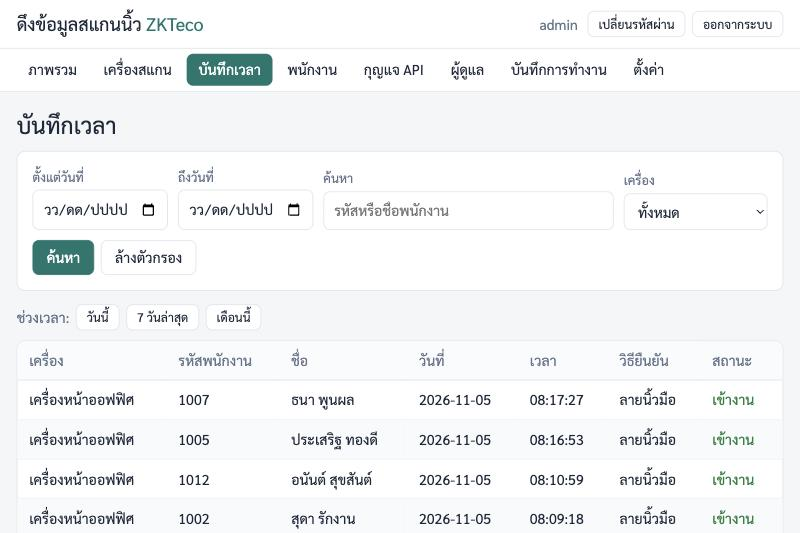
*รูปที่ 11: หน้าบันทึกเวลา*

ตารางแสดงบันทึกเรียง **ใหม่สุดก่อน** คอลัมน์: **เครื่อง**, **รหัสพนักงาน**, **ชื่อ**, **วันที่**, **เวลา**, **วิธียืนยัน** (ลายนิ้วมือ / ใบหน้า / บัตร / รหัสผ่าน / อื่น ๆ), **สถานะ** (เข้างาน / ออกงาน / พักออก / พักเข้า / OT เข้า / OT ออก / ไม่ระบุ)

เวลาที่เห็นคือ **เวลาตามนาฬิกาของเครื่องสแกน**

**ตัวกรอง** (ใช้ร่วมกันได้ แล้วกด **ค้นหา**):

| ตัวกรอง | ความหมาย |
|---|---|
| **ตั้งแต่วันที่** / **ถึงวันที่** | ช่วงวันที่ (รวมวันแรกและวันสุดท้ายทั้งวัน) |
| **ค้นหา** | พิมพ์ส่วนหนึ่งของรหัสพนักงานหรือชื่อ (ไม่สนตัวพิมพ์เล็ก/ใหญ่) |
| **เครื่อง** | เลือกเครื่องเดียว หรือ "ทั้งหมด" |

- ปุ่ม **ล้างตัวกรอง** เคลียร์ทุกตัวกรอง
- แถว **ช่วงเวลา:** มีปุ่มลัด **วันนี้**, **7 วันล่าสุด**, **เดือนนี้** (คงคำค้นและเครื่องที่เลือกไว้)
- แสดงหน้าละ 100 รายการ ด้านล่างบอก "แสดงรายการที่ ... จากทั้งหมด ... รายการ" ใช้ **‹ ก่อนหน้า** / **ถัดไป ›** เปลี่ยนหน้า
- ถ้าไม่พบ จะขึ้น "ไม่พบบันทึกเวลาตามตัวกรองนี้"

### 7.2 ส่งออก CSV (เปิดใน Excel)

กดปุ่ม **บันทึกเป็น CSV** ด้านล่างตาราง

- ได้ไฟล์ `attendance_ปีเดือนวัน_ชั่วโมงนาทีวินาที.csv` มี **ทุกรายการที่ตรงกับตัวกรองตอนนี้** (ไม่ใช่เฉพาะหน้าที่เห็น) ดังนั้นตั้งตัวกรองให้ถูกก่อนกด
- คอลัมน์ในไฟล์: เครื่อง, รหัสพนักงาน, ชื่อ, วันที่, เวลา, รหัสวิธียืนยัน, วิธียืนยัน, รหัสสถานะ, สถานะ
- **เปิดด้วย Excel:** ดับเบิลคลิกไฟล์ได้เลย ภาษาไทยแสดงถูก (ไฟล์เป็น UTF-8 แบบมี BOM)
  ถ้าตัวอักษรไทยเพี้ยน ให้เปิด Excel เปล่า แล้วเลือก **ข้อมูล (Data) > จากข้อความ/CSV (From Text/CSV)** เลือกไฟล์ และตั้ง **File Origin** เป็น **UTF-8 (65001)**
- ถ้า Excel ตัดเลขศูนย์หน้ารหัสพนักงาน (เช่น `0012` กลายเป็น `12`) ให้ใช้วิธี "จากข้อความ/CSV" แล้วตั้งคอลัมน์ **รหัสพนักงาน** เป็นชนิด **ข้อความ (Text)**
- ข้อความที่ขึ้นต้นด้วย `=`, `+`, `-`, `@` ในชื่อ/รหัส จะถูกใส่เครื่องหมาย `'` นำหน้าให้ เพื่อกัน Excel เข้าใจผิดว่าเป็นสูตร

### 7.3 เมนู "พนักงาน"

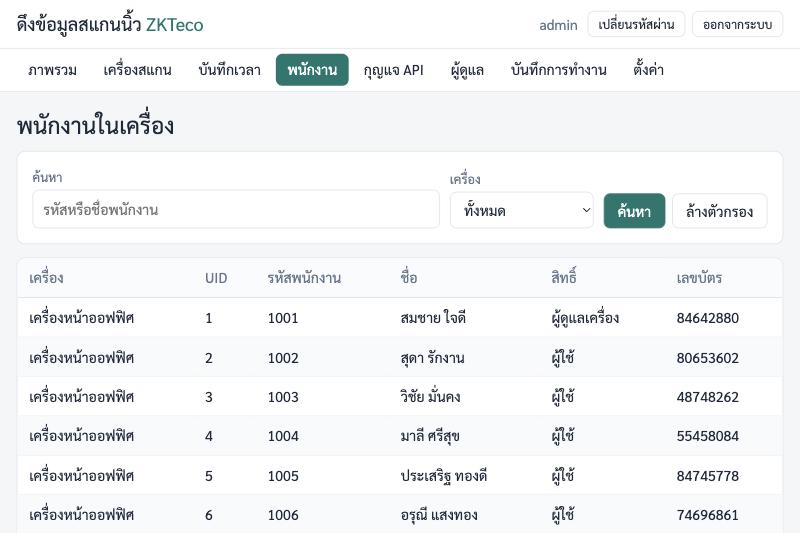
*รูปที่ 12: หน้าพนักงานในเครื่อง*

แสดงรายชื่อพนักงานที่ลงทะเบียนอยู่ในเครื่องสแกน: **เครื่อง**, **UID** (ลำดับภายในเครื่อง), **รหัสพนักงาน**, **ชื่อ**, **สิทธิ์** (ผู้ใช้ / ผู้ดูแลเครื่อง), **เลขบัตร**
ค้นหาด้วยรหัสหรือชื่อ และเลือกเครื่องได้ ปุ่ม **บันทึกเป็น CSV** ส่งออกรายชื่อ (ไฟล์ `staff_....csv`)
หน้านี้แสดงเฉพาะ 1,000 คนแรก ถ้ามีมากกว่านี้ให้ค้นหาหรือส่งออก CSV เพื่อดูทั้งหมด
ถ้าตารางว่าง ให้กด **ดึงข้อมูลทุกเครื่อง** ที่หน้าภาพรวมก่อน

พนักงานคนเดียวกันที่ลงทะเบียนไว้หลายเครื่องจะแสดงหลายแถว (หนึ่งแถวต่อเครื่อง)

---

## 8. ตั้งรอบดึงอัตโนมัติ

เมนู **ตั้งค่า**

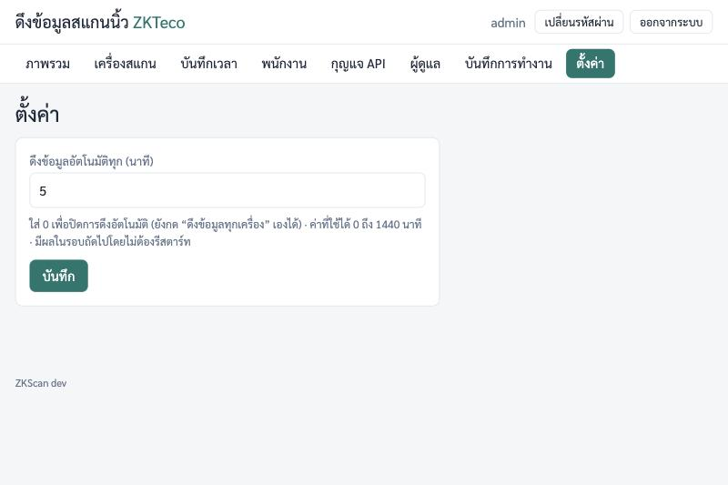
*รูปที่ 13: หน้าตั้งค่า*

1. ช่อง **ดึงข้อมูลอัตโนมัติทุก (นาที)** ใส่จำนวนนาที (ค่าเริ่มต้น `5`)
2. กด **บันทึก**

- ค่าที่ใช้ได้ 0 ถึง 1440 นาที
- ใส่ `0` = **ปิดการดึงอัตโนมัติ** (ยังกด **ดึงข้อมูลทุกเครื่อง** เองได้)
- มีผลในรอบถัดไป **ไม่ต้องรีสตาร์ท**
- รอบนี้ใช้กับทุกเครื่องที่ติ๊ก **เปิดใช้งาน** ไว้ ถ้าไม่อยากให้เครื่องไหนถูกดึงอัตโนมัติ ให้เข้า **แก้ไข** เครื่องนั้นแล้วเอาติ๊ก **เปิดใช้งาน (ดึงข้อมูลตามรอบอัตโนมัติ)** ออก
- หลังเปิดโปรแกรมประมาณ 5 วินาที จะดึงรอบแรก (ถ้าไม่ได้ปิดรอบไว้ด้วย 0) จากนั้นดึงตามรอบที่ตั้ง
- ระบบ HR ที่ดึงข้อมูลผ่าน API จะได้ข้อมูลใหม่ตามรอบนี้ (หรือเรียก `POST /api/pull` เพื่อสั่งดึงทันที)

---

## 9. ให้ระบบ HR ดึงข้อมูล (กุญแจ API)

API ทุกเส้นต้องมี **กุญแจ API** ไม่มีกุญแจ = ใช้ไม่ได้ แนะนำให้ **ทำกุญแจแยกต่อหนึ่งระบบ** และ **จำกัด IP**

### 9.1 สร้างกุญแจ

1. เมนู **กุญแจ API** ฟอร์ม **สร้างกุญแจใหม่** ทางขวา
2. ช่อง **ชื่อ (ระบบที่จะใช้)** ใส่ชื่อ เช่น `ระบบ HR`
3. ช่อง **IP ที่อนุญาต (ไม่บังคับ)** ใส่ **IP ของ server ระบบ HR** บรรทัดละหนึ่งรายการ (IP เดี่ยว เช่น `192.168.1.20` หรือช่วง เช่น `192.168.1.0/24`)
   ถ้าเว้นว่าง กุญแจนี้จะใช้ได้จากทุก IP (ไม่แนะนำ)
4. กด **สร้างกุญแจ**

IP ที่ใส่ต้องเป็น IP ที่ zkscan เห็นจริงตอนระบบ HR เรียกเข้ามา (ถ้าระบบ HR ออกมาผ่าน NAT หรือ proxy ให้ใช้ IP ของ NAT/proxy) ระบบไม่เชื่อค่า `X-Forwarded-For`

### 9.2 คัดลอกกุญแจ (แสดงครั้งเดียว)

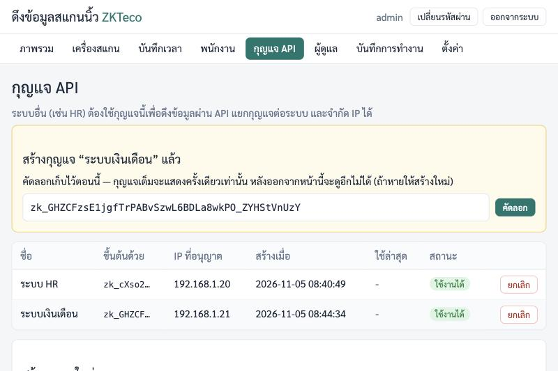
*รูปที่ 14: กล่องเหลืองแสดงกุญแจที่เพิ่งสร้าง (กุญแจในรูปเป็นของระบบทดสอบ ใช้งานไม่ได้แล้ว)*

หลังสร้างจะมีกล่องเหลือง "สร้างกุญแจ “...” แล้ว" แสดง **กุญแจเต็ม** (ขึ้นต้นด้วย `zk_`)

> **กุญแจเต็มแสดงครั้งเดียวเท่านั้น** กดปุ่ม **คัดลอก** แล้วเก็บไว้ในที่ปลอดภัยทันที ออกจากหน้านี้แล้วดูอีกไม่ได้ (ในตารางจะเห็นแค่ตัวขึ้นต้น เช่น `zk_cXso2…`)
> ถ้าหาย ต้องสร้างกุญแจใหม่ แล้วยกเลิกอันเก่า
> ถ้าปุ่มคัดลอกไม่ทำงาน (เช่น เปิดผ่าน http) ให้ลากคลุมข้อความกุญแจแล้วกด Ctrl+C

ตารางกุญแจมีคอลัมน์: **ชื่อ**, **ขึ้นต้นด้วย**, **IP ที่อนุญาต**, **สร้างเมื่อ**, **ใช้ล่าสุด**, **สถานะ** (ใช้งานได้ / ยกเลิกแล้ว)

### 9.3 ตัวอย่างคำสั่ง curl ที่อยู่ในหน้า

ใต้ฟอร์มมีหัวข้อ **ตัวอย่างการเรียกใช้ (curl)** พร้อมปุ่ม **คัดลอก** ตอนที่เพิ่งสร้างกุญแจ ตัวอย่างจะใส่กุญแจจริงให้แล้ว (ที่อยู่ server ใช้ตามที่คุณเปิดเบราว์เซอร์เข้ามา)
ถ้าเข้าหน้านี้ภายหลัง จะเป็น `<กุญแจ API ของคุณ>` ให้แทนที่เอง

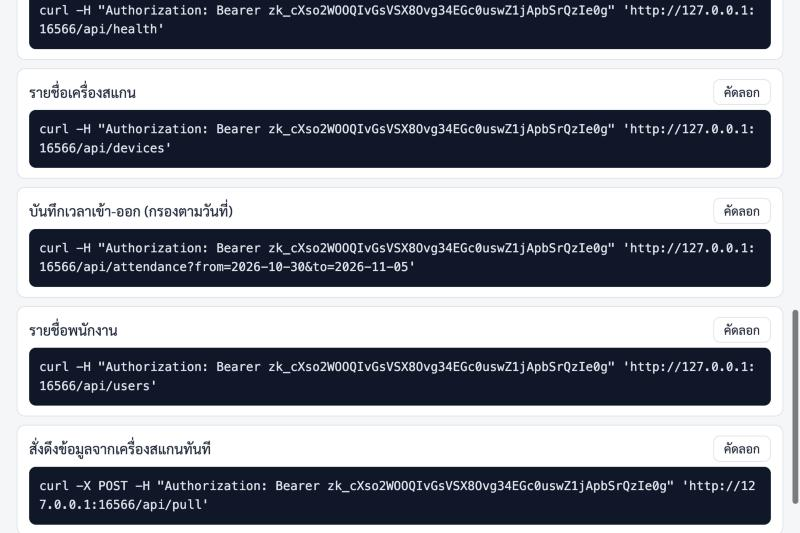
*รูปที่ 15: ตัวอย่าง curl พร้อมคัดลอก*

ตัวอย่างมี 5 แบบ: ตรวจสถานะระบบ (`/api/health`), รายชื่อเครื่องสแกน (`/api/devices`), บันทึกเวลาเข้า-ออก กรองตามวันที่ (`/api/attendance`), รายชื่อพนักงาน (`/api/users`), สั่งดึงข้อมูลทันที (`/api/pull`)
ลองวางในหน้าต่างคำสั่งของ server หรือคอมพิวเตอร์ในวงแลน: ถ้าได้ JSON กลับมา แสดงว่ากุญแจใช้ได้

(ข้อสังเกต: ตัวอย่างในหน้านี้ใช้ที่อยู่ที่คุณเปิดเบราว์เซอร์เข้ามา ถ้าคุณเข้าด้วย `localhost` หรือชื่ออื่น ให้เปลี่ยนเป็น IP ที่ระบบ HR ใช้เรียกจริงก่อนส่งต่อ)

### 9.4 สิ่งที่ต้องส่งให้นักพัฒนาระบบ HR

ส่งให้ **ผ่านช่องทางที่ปลอดภัย** (ไม่ส่งกุญแจในกลุ่มแชตสาธารณะ):

1. **URL ของ API** เช่น `http://192.168.1.50:6565` (ฐาน) และ IP ของ server ที่รัน zkscan ต้องเข้าถึงได้จาก server HR (ตรวจไฟร์วอลล์ พอร์ต 6565)
2. **กุญแจ API** (`zk_...`) ที่คัดลอกไว้
3. ไฟล์คู่มือ **[docs/API.th.md](API.th.md)** (หรือลิงก์ไปที่ไฟล์นี้ใน GitHub)
4. แจ้งว่ากุญแจผูกกับ IP ใด (ถ้าจำกัดไว้) เพื่อให้เรียกจากเครื่องนั้นเท่านั้น
5. ถ้าเปิด HTTPS ด้วยใบรับรอง self-signed ต้องแจ้งด้วย เพื่อให้ฝั่ง HR ติดตั้งใบรับรองให้เชื่อถือ

### 9.5 ยกเลิก หรือเปลี่ยนกุญแจ

- **ยกเลิก:** ในตาราง กดปุ่ม **ยกเลิก** ท้ายแถว (ถามยืนยันก่อน) สถานะจะเป็น **ยกเลิกแล้ว** ระบบที่ใช้กุญแจนี้จะเรียก API ไม่ได้อีก (ได้ 401) และ **กู้คืนไม่ได้**
- **เปลี่ยนกุญแจ (แทนของเดิม เช่น กุญแจรั่วหรือหาย):**
  1. สร้างกุญแจใหม่ (9.1) และส่งให้ผู้พัฒนา HR
  2. ให้ HR เปลี่ยนไปใช้กุญแจใหม่
  3. ตรวจว่าคอลัมน์ **ใช้ล่าสุด** ของกุญแจใหม่ขยับ แปลว่าใช้ได้
  4. กด **ยกเลิก** กุญแจเก่า
- กุญแจที่ไม่มีคนใช้แล้วให้ยกเลิกทิ้ง
- ดูว่ากุญแจถูกใช้ล่าสุดเมื่อไรได้จากคอลัมน์ **ใช้ล่าสุด**

---

## 10. ผู้ดูแลหลายคน และการลืมรหัสผ่าน

ทุกคนที่ล็อกอินเป็น "ผู้ดูแล" มีสิทธิ์เท่ากันหมด (มีบทบาทเดียว) จึงควรมีเท่าที่จำเป็น

### 10.1 เพิ่มผู้ดูแล

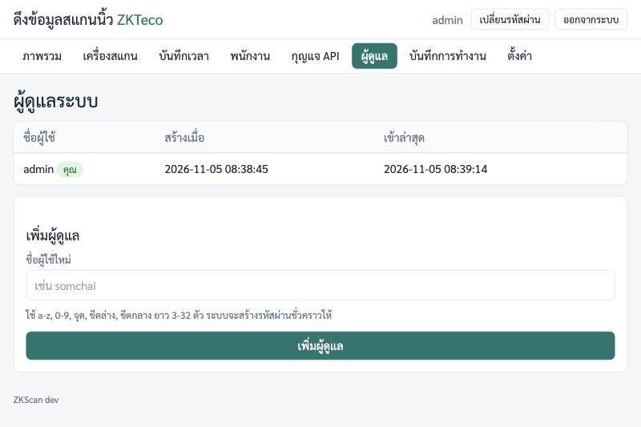
*รูปที่ 16: หน้าผู้ดูแลระบบ*

1. เมนู **ผู้ดูแล** (หน้าชื่อ "ผู้ดูแลระบบ")
2. ช่อง **ชื่อผู้ใช้ใหม่** ใส่ชื่อ เช่น `somchai` กด **เพิ่มผู้ดูแล**
   - ใช้ได้เฉพาะ `a-z`, `0-9`, จุด (.), ขีดล่าง (_), ขีดกลาง (-) ยาว 3-32 ตัว (ตัวพิมพ์ใหญ่จะถูกแปลงเป็นตัวเล็ก)
3. ระบบสร้าง **รหัสผ่านชั่วคราว** แสดงในกล่องเหลือง **ครั้งเดียว** ให้คัดลอกหรือจดแล้วส่งให้เจ้าของบัญชี
4. เจ้าของบัญชีล็อกอินด้วยรหัสนั้น และจะถูกบังคับให้ตั้งรหัสใหม่ทันที (ในตารางจะมีป้าย **รอตั้งรหัสใหม่** จนกว่าจะตั้ง)

ตารางแสดง **ชื่อผู้ใช้**, **สร้างเมื่อ**, **เข้าล่าสุด** บัญชีของคุณเองมีป้าย **คุณ**

### 10.2 รีเซ็ตรหัส และลบ

ปุ่มท้ายแถวของ **ผู้ดูแลคนอื่น** (ไม่มีให้กับบัญชีของคุณเอง):

- **รีเซ็ตรหัส:** (ถามยืนยัน) ออกรหัสชั่วคราวใหม่ให้ แสดงครั้งเดียว เจ้าของบัญชีถูกออกจากระบบทุกเครื่อง และต้องตั้งรหัสใหม่ตอนเข้าครั้งหน้า
- **ลบ:** (ถามยืนยัน) ลบบัญชีนั้น

กติกา:

- รีเซ็ตรหัสของ **ตัวเอง** ไม่ได้ ให้ใช้ปุ่ม **เปลี่ยนรหัสผ่าน** มุมขวาบนแทน
- ลบบัญชีที่ **ตัวเองกำลังใช้อยู่** ไม่ได้
- ลบ **ผู้ดูแลคนสุดท้าย** ไม่ได้ ต้องมีอย่างน้อย 1 คนเสมอ

### 10.3 ลืมรหัสผ่าน

**ถ้ามีผู้ดูแลคนอื่นอยู่:** ให้เขาล็อกอินแล้วกด **รีเซ็ตรหัส** ให้ (10.2)

**ถ้าเป็นผู้ดูแลคนเดียว (หรือทุกคนลืม):** ใช้คำสั่งบน server ออกรหัสชั่วคราวใหม่ (ต้องมีสิทธิ์ sudo บน server)

ติดตั้งแบบ systemd:

```bash
sudo -u zkscan env ZKSCAN_DATA=/var/lib/zkscan /usr/local/bin/zkscan reset-password admin
```

ติดตั้งแบบ Docker (รันในโฟลเดอร์ `zkscan`):

```bash
docker compose exec zkscan zkscan reset-password admin
```

คำสั่งจะพิมพ์ `รหัสผ่านชั่วคราวของ admin: ...` แล้วให้ล็อกอินด้วยรหัสนี้ ระบบจะบังคับตั้งรหัสใหม่ (การล็อกอินเดิมถูกยกเลิกทั้งหมด)
เปลี่ยน `admin` เป็นชื่อผู้ใช้อื่นได้ถ้าต้องการรีเซ็ตคนอื่น

---

## 11. บันทึกการทำงาน

เมนู **บันทึกการทำงาน** แสดง 200 เหตุการณ์ล่าสุด: เวลา, ระดับ (ข้อมูล / เตือน / ผิดพลาด), หมวด, ข้อความ

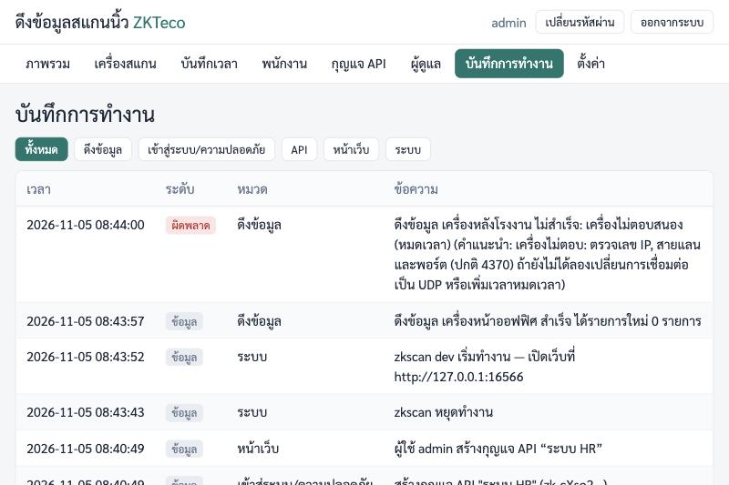
*รูปที่ 17: บันทึกการทำงาน*

ปุ่มกรองตามหมวด: **ทั้งหมด**, **ดึงข้อมูล** (ผลการดึงแต่ละเครื่อง รวมสาเหตุที่ดึงไม่สำเร็จ), **เข้าสู่ระบบ/ความปลอดภัย** (ล็อกอิน, กุญแจ API, กุญแจถูกปฏิเสธเพราะ IP), **API**, **หน้าเว็บ** (ใครกดอะไร เช่น เพิ่ม/แก้/ลบเครื่อง), **ระบบ** (เริ่ม/หยุดโปรแกรม)

เมื่อมีอะไรผิดปกติ ให้เปิดหน้านี้ก่อน เลือก **ดึงข้อมูล** เพื่อดูว่าเครื่องไหนดึงไม่สำเร็จเพราะอะไร

---

## 12. เปิด HTTPS ไฟร์วอลล์ และเปลี่ยนพอร์ต

### 12.1 เปิด HTTPS (แนะนำ)

ถ้าไม่เปิด HTTPS รหัสผ่านของผู้ดูแลและกุญแจ API จะวิ่งในวงแลนแบบ **ไม่เข้ารหัส** ใครที่ดักข้อมูลในเครือข่ายได้ก็อ่านได้ จึงแนะนำให้เปิด

**ติดตั้งแบบ systemd**

1. มีไฟล์ใบรับรองและกุญแจส่วนตัวรูปแบบ PEM (จาก CA ภายในองค์กร หรือสร้างแบบ self-signed ตามตัวอย่างข้างล่าง) วางไว้ใน `/etc/zkscan` โดยเจ้าของเป็น `root:zkscan` และไฟล์กุญแจสิทธิ์ `0640`
2. แก้ไฟล์ตั้งค่า (ตัวติดตั้งใส่ตัวอย่างที่ถูกคอมเมนต์ไว้ให้แล้ว):

   ```bash
   sudoedit /etc/zkscan/zkscan.env
   ```

   เอาเครื่องหมาย `#` หน้าสองบรรทัดนี้ออก (ต้องตั้ง **ทั้งคู่**):

   ```
   ZKSCAN_TLS_CERT=/etc/zkscan/server.crt
   ZKSCAN_TLS_KEY=/etc/zkscan/server.key
   ```

3. รีสตาร์ทแล้วเข้าที่ `https://<IP>:6565`:

   ```bash
   sudo systemctl restart zkscan
   ```

ตัวอย่างสร้างใบรับรองแบบ **self-signed** (อายุ 825 วัน เปลี่ยน `192.168.1.10` เป็น IP ของ server) คัดลอกไปวางทั้งบรรทัดเดียว:

```bash
sudo openssl req -x509 -newkey rsa:2048 -nodes -days 825 -subj "/CN=zkscan" -addext "subjectAltName=IP:192.168.1.10" -keyout /etc/zkscan/server.key -out /etc/zkscan/server.crt && sudo chown root:zkscan /etc/zkscan/server.key /etc/zkscan/server.crt && sudo chmod 0640 /etc/zkscan/server.key && sudo chmod 0644 /etc/zkscan/server.crt
```

- เบราว์เซอร์จะเตือนว่า "ไม่ปลอดภัย/ไม่น่าเชื่อถือ" จนกว่าจะติดตั้งไฟล์ `server.crt` เป็นใบรับรองที่เชื่อถือบนเครื่องผู้ใช้ (หรือใช้ใบรับรองจาก CA ภายในองค์กร)
- เมื่อเปิด HTTPS แล้ว ใช้ **พอร์ตเดิม** (6565) และ URL ของ API ต้องขึ้นต้นด้วย `https://` (แจ้งนักพัฒนา HR ด้วย)
- ถ้าตั้งไม่ครบทั้งสองตัว หรือไฟล์อ่านไม่ได้ บริการจะเริ่มไม่ขึ้น ดูสาเหตุด้วย `sudo journalctl -u zkscan -n 50 --no-pager`

**ติดตั้งแบบ Docker**

วางไฟล์ใบรับรองไว้ในโฟลเดอร์ `certs/` ข้าง `docker-compose.yml` (ไฟล์ต้องอ่านได้โดยผู้ใช้ 65532 เช่น `chmod 0644`) ชื่อ `server.crt` และ `server.key`
แล้วแก้ `docker-compose.yml` เอาเครื่องหมาย `#` ออกจากสามบรรทัด: `ZKSCAN_TLS_CERT`, `ZKSCAN_TLS_KEY` และ `./certs:/certs:ro` จากนั้น `docker compose up -d`

**ทางเลือก: วางหลัง reverse proxy** (nginx, Caddy ฯลฯ) ที่ทำ HTTPS อยู่แล้ว
- โปรแกรม **ไม่เชื่อ** header `X-Forwarded-*` ดังนั้นรายการ IP ที่อนุญาตของกุญแจ API จะเห็นเป็น IP ของ proxy ไม่ใช่ของเครื่อง HR (ควรจำกัดการเข้าถึงที่ proxy ด้วย)
- proxy ต้องส่ง header `Host` เดิมที่ผู้ใช้เปิดเข้ามาต่อให้ zkscan ไม่เช่นนั้นการกดปุ่มในหน้าเว็บจะขึ้น "คำขอถูกปฏิเสธ (ไม่ได้มาจากหน้าเว็บนี้)" (zkscan ตรวจว่าคำขอมาจากหน้าเว็บของตัวเอง)
- ให้ zkscan รับการเชื่อมต่อจาก proxy เท่านั้น เช่นตั้ง `ZKSCAN_LISTEN=127.0.0.1:6565`

### 12.2 ไฟร์วอลล์

ถ้าเปิดเว็บจากเครื่องอื่นไม่ได้ ส่วนใหญ่เพราะไฟร์วอลล์ของ server ปิดพอร์ต 6565 (ถ้าติดตั้งไม่มีไฟร์วอลล์เปิดอยู่ จะไม่ต้องทำขั้นนี้)

**Ubuntu / Debian (ufw):**

```bash
sudo ufw allow 6565/tcp
# หรือเปิดเฉพาะวงแลนของคุณ (ปลอดภัยกว่า เปลี่ยน 192.168.1.0/24 ให้ตรงกับวงแลนของคุณ):
sudo ufw allow from 192.168.1.0/24 to any port 6565 proto tcp
sudo ufw status
```

**Rocky / AlmaLinux / CentOS / Fedora (firewalld):**

```bash
sudo firewall-cmd --permanent --add-port=6565/tcp
sudo firewall-cmd --reload
sudo firewall-cmd --list-ports
```

zkscan ออกแบบมาให้ใช้ในวงแลน **อย่าเปิดพอร์ต 6565 ออกอินเทอร์เน็ตโดยตรง** ถ้าต้องการเข้าจากภายนอก ให้ผ่าน VPN หรือวางหลัง reverse proxy ที่มี HTTPS
(ขาออกจาก server ไปหาเครื่องสแกนพอร์ต 4370 ปกติไม่ต้องตั้งไฟร์วอลล์ของ server แต่ถ้ามีไฟร์วอลล์คั่นระหว่างเครือข่าย ต้องอนุญาตพอร์ต 4370 ด้วย)

### 12.3 เปลี่ยนพอร์ต หรือการตั้งค่าอื่น

**systemd:** แก้ไฟล์ `/etc/zkscan/zkscan.env` (ไม่ต้องใส่เครื่องหมายคำพูด) แล้วรีสตาร์ท

```bash
sudoedit /etc/zkscan/zkscan.env      # เช่น เปลี่ยนเป็น ZKSCAN_LISTEN=:8080
sudo systemctl restart zkscan
```

- ใช้พอร์ตตั้งแต่ 1024 ขึ้นไป (บริการรันแบบไม่มีสิทธิ์พิเศษ จึงเปิดพอร์ต 80/443 โดยตรงไม่ได้ ถ้าต้องการให้ใช้ reverse proxy)
- เปลี่ยนพอร์ตแล้วต้องเปิดพอร์ตใหม่ในไฟร์วอลล์ (12.2) และแจ้ง URL ใหม่ให้ระบบ HR
- ค่าที่ตั้งได้ในไฟล์: `ZKSCAN_LISTEN` (ค่าเริ่มต้น `:6565` คือทุกการ์ดเครือข่าย ใส่ IP หน้าเครื่องหมาย `:` เพื่อรับเฉพาะ IP นั้น เช่น `192.168.1.50:6565`), `ZKSCAN_DATA` (โฟลเดอร์ข้อมูล), `ZKSCAN_TLS_CERT` และ `ZKSCAN_TLS_KEY` (HTTPS)

**Docker:** เปลี่ยนด้านซ้ายของ `ports:` ใน `docker-compose.yml` เช่น `"8080:6565"` แล้ว `docker compose up -d`
ถ้าต้องการผูกพอร์ตกับ IP ของวงแลนเพียงตัวเดียว ใช้บรรทัดตัวอย่างที่คอมเมนต์ไว้ในไฟล์ (`"192.168.1.10:6565:6565"`)

---

## 13. งานดูแลประจำ

### 13.1 สำรองข้อมูล (backup)

ข้อมูลทั้งหมด (บันทึกเวลา พนักงาน กุญแจ API บัญชีผู้ดูแล) อยู่ในไฟล์ฐานข้อมูล `zkscan.db` (และไฟล์ข้างเคียงที่ชื่อขึ้นต้น `zkscan.db`)
ไฟล์นี้มีข้อมูลส่วนบุคคลของพนักงาน เก็บสำเนาไว้ในที่ที่เข้าถึงได้เฉพาะผู้เกี่ยวข้อง ควรสำรองสม่ำเสมอ (เช่นทุกสัปดาห์) และเก็บไว้นอกเครื่อง server ด้วย

**systemd** (หยุดบริการสั้น ๆ เพื่อให้ไฟล์สมบูรณ์ แล้วคัดลอก):

```bash
sudo systemctl stop zkscan
mkdir -p ~/zkscan-backup-$(date +%F)
sudo cp /var/lib/zkscan/zkscan.db* ~/zkscan-backup-$(date +%F)/
sudo cp /etc/zkscan/zkscan.env ~/zkscan-backup-$(date +%F)/
sudo chown -R "$USER": ~/zkscan-backup-$(date +%F)
sudo systemctl start zkscan
```

(ระหว่างหยุดบริการไม่มีการดึงข้อมูล แต่ข้อมูลที่ยังอยู่ในเครื่องสแกนจะถูกดึงในรอบถัดไป ไม่สูญหาย)

**Docker** (รันในโฟลเดอร์ `zkscan`):

```bash
docker compose stop zkscan
docker run --rm -v zkscan_zkscan-data:/data -v "$PWD":/backup alpine sh -c 'cp /data/zkscan.db* /backup/'
docker compose start zkscan
```

ชื่อ volume ขึ้นกับชื่อโฟลเดอร์โปรเจกต์ (โฟลเดอร์ชื่อ `zkscan` จะได้ `zkscan_zkscan-data`) ดูชื่อจริงด้วย `docker volume ls`

### 13.2 กู้คืนข้อมูล (restore)

**systemd:**

```bash
sudo systemctl stop zkscan
sudo rm -f /var/lib/zkscan/zkscan.db /var/lib/zkscan/zkscan.db-wal /var/lib/zkscan/zkscan.db-shm
sudo cp ~/zkscan-backup-2026-11-05/zkscan.db* /var/lib/zkscan/
sudo chown zkscan:zkscan /var/lib/zkscan/zkscan.db*
sudo systemctl start zkscan
```

(เปลี่ยน `zkscan-backup-2026-11-05` เป็นชื่อโฟลเดอร์สำรองของคุณ)

**Docker:**

```bash
docker compose stop zkscan
docker run --rm -v zkscan_zkscan-data:/data -v "$PWD":/backup alpine sh -c 'rm -f /data/zkscan.db* && cp /backup/zkscan.db* /data/ && chown 65532:65532 /data/zkscan.db*'
docker compose start zkscan
```

(ไฟล์ `zkscan.db*` ที่จะกู้คืนต้องอยู่ในโฟลเดอร์ปัจจุบัน)

### 13.3 อัปเดตเป็นเวอร์ชันใหม่

ควรสำรองข้อมูล (13.1) ก่อนทุกครั้ง

**systemd:**

```bash
cd zkscan
git pull
sudo ./install.sh
```

ข้อมูลและการตั้งค่าเดิมไม่ถูกแตะต้อง ตัวติดตั้งจะรีสตาร์ทบริการให้เอง
ข้อควรระวัง: ถ้ามีโฟลเดอร์ `dist/` เก่าค้างอยู่ ตัวติดตั้งจะใช้ไฟล์ในนั้นแทนการคอมไพล์ใหม่ ให้ลบ (`rm -rf dist`) หรือรัน `make dist` ใหม่ก่อน
ดูเวอร์ชันที่ติดตั้ง: `/usr/local/bin/zkscan version` (เวอร์ชันแสดงที่มุมล่างของทุกหน้าเว็บด้วย)

**Docker:**

```bash
cd zkscan
git pull
docker compose up -d --build
```

### 13.4 ดู log และสถานะ (systemd)

```bash
sudo systemctl status zkscan           # สถานะบริการ (กด q เพื่อออก)
sudo journalctl -u zkscan -f           # ดู log สด ๆ (กด Ctrl+C เพื่อออก)
sudo journalctl -u zkscan -n 100       # 100 บรรทัดล่าสุด
```

Docker: `docker compose logs -f zkscan`

ในหน้าเว็บ เมนู **บันทึกการทำงาน** ก็แสดงเหตุการณ์ล่าสุดและสาเหตุที่ดึงเครื่องไหนไม่สำเร็จ (หัวข้อ 11)

### 13.5 รีสตาร์ท / หยุด / เริ่ม

```bash
sudo systemctl restart zkscan
sudo systemctl stop zkscan
sudo systemctl start zkscan
```

บริการเริ่มเองทุกครั้งที่เปิดเครื่อง และเริ่มใหม่เองถ้าโปรแกรมล้มเหลว (รอ 5 วินาที) Docker: `docker compose restart zkscan`

### 13.6 ถอนการติดตั้ง

**systemd** (รันในโฟลเดอร์ `zkscan`):

```bash
sudo ./deploy/uninstall.sh            # ลบโปรแกรมและบริการ แต่ "เก็บข้อมูลและการตั้งค่าไว้"
sudo ./deploy/uninstall.sh --purge    # ลบทุกอย่างรวมข้อมูล กู้คืนไม่ได้
```

- แบบแรก ติดตั้งใหม่ภายหลัง (`sudo ./install.sh`) จะใช้ข้อมูลเดิมต่อได้
- `--purge` ลบ `/var/lib/zkscan` (ข้อมูล), `/etc/zkscan` (ไฟล์ตั้งค่า) และผู้ใช้ระบบ `zkscan` ถามยืนยันก่อน ให้พิมพ์ `ใช่` หรือ `yes` แล้วกด Enter
  (ใส่ `--yes` เพิ่มเพื่อข้ามคำถาม: `sudo ./deploy/uninstall.sh --purge --yes`) **สำรองข้อมูลก่อน** ถ้าอาจต้องใช้อีก

**Docker:**

```bash
docker compose down        # เก็บข้อมูลไว้
docker compose down -v     # ลบ volume ข้อมูลด้วย กู้คืนไม่ได้
```

---

## 14. แก้ปัญหาที่พบบ่อย

| อาการ | สาเหตุที่น่าจะเป็น | วิธีแก้ |
|---|---|---|
| เปิดเว็บจากเครื่องอื่นไม่ได้ | ไฟร์วอลล์ของ server ปิดพอร์ต 6565 / บริการไม่ได้ทำงาน / พิมพ์ IP ผิด / ใช้ `https://` ทั้งที่ไม่ได้เปิด HTTPS (หรือกลับกัน) | เปิดพอร์ต (12.2), เช็ก `sudo systemctl status zkscan`, ตรวจ IP ด้วย `hostname -I` บน server |
| บริการไม่ขึ้นหลังติดตั้ง | พอร์ตถูกใช้อยู่ หรือไฟล์ตั้งค่าผิด | `sudo journalctl -u zkscan -n 50 --no-pager` ถ้าพอร์ตชน เปลี่ยน `ZKSCAN_LISTEN` (12.3) |
| ล็อกอินไม่ได้ ขึ้น "ชื่อผู้ใช้หรือรหัสผ่านไม่ถูกต้อง" | พิมพ์ผิด (ระวังตัวพิมพ์ใหญ่/เล็กของรหัส และภาษาแป้นพิมพ์) หรือลืมรหัส | ถ้าลืม ดู 10.3 |
| ล็อกอินผิดหลายครั้งแล้วเข้าไม่ได้ ("ลองใหม่ใน 15 นาที") | ระบบล็อกชั่วคราวกันการเดารหัส | รอ 15 นาที แล้วลองใหม่ (หรือให้ผู้ดูแลอื่นรีเซ็ตรหัสให้) |
| ล็อกอินแล้วถูกเด้งกลับหน้าเข้าสู่ระบบ | ครบ 12 ชั่วโมง หรือถูกรีเซ็ตรหัส/ลบบัญชี | ล็อกอินใหม่ |
| กดปุ่มในหน้าเว็บแล้วขึ้น "คำขอถูกปฏิเสธ (ไม่ได้มาจากหน้าเว็บนี้)" | เข้าผ่าน reverse proxy ที่ไม่ส่ง `Host` เดิม หรือมีเครื่องมือตัด header ของเบราว์เซอร์ | ตั้ง proxy ให้ส่ง `Host` ต่อ (12.1) หรือเข้าตรงที่ `http(s)://<IP>:6565` |
| ทดสอบเครื่องสแกนไม่ผ่าน | IP/พอร์ต/Comm Key ผิด หรือเครือข่ายไม่ถึง | ดูตารางข้อความในหัวข้อ 6.4, เช็ก `ping <IP>` และ `nc -vz <IP> 4370`, ลองสลับ TCP/UDP |
| ดึงได้ครั้งแรก แต่หลัง ๆ ขึ้น "ดึงข้อมูลไม่สำเร็จ" | IP เครื่องสแกนเปลี่ยน (DHCP), เครื่องปิด/สายหลุด, เครือข่ายล่ม | ดูข้อความบนการ์ดเครื่องในหน้าภาพรวม ตั้ง IP เครื่องสแกนเป็นแบบคงที่ |
| ข้อมูลใหม่ไม่เข้า ทั้งที่มีคนสแกน | ปิดการดึงอัตโนมัติ (ตั้ง 0) หรือเครื่องถูกติ๊ก "เปิดใช้งาน" ออก | ดูเมนู **ตั้งค่า** และหน้าแก้ไขเครื่อง หรือกด **ดึงข้อมูลทุกเครื่อง** |
| เวลาของบันทึกไม่ตรงเวลาจริง | นาฬิกาของเครื่องสแกนเพี้ยน (เวลาสแกนใช้ตามนาฬิกาเครื่องสแกน) | ในหน้าแก้ไขเครื่อง กด **ตั้งเวลาเครื่อง (ตามเวลาเซิร์ฟเวอร์)** (ตรวจให้นาฬิกา server ถูกก่อน) |
| เวลาใน "บันทึกการทำงาน"/log ไม่ตรงเวลาไทย | เขตเวลาของ server | `sudo timedatectl set-timezone Asia/Bangkok` แล้ว `sudo systemctl restart zkscan` (Docker: ดูหัวข้อ 4) |
| เปิดไฟล์ CSV ใน Excel แล้วภาษาไทยเพี้ยน หรือรหัสพนักงานเลขศูนย์หาย | Excel เดาชนิดข้อมูลเอง | ใช้ **ข้อมูล > จากข้อความ/CSV** ตามหัวข้อ 7.2 |
| ระบบ HR ได้ 401 | ไม่ส่งกุญแจ ส่งผิดชนิด หรือกุญแจถูกยกเลิก | ตรวจ header ตาม [คู่มือ API](API.th.md) ดูสถานะกุญแจในเมนู **กุญแจ API** ถ้าจำเป็นให้สร้างกุญแจใหม่ |
| ระบบ HR ได้ 403 | IP ของ HR ไม่อยู่ในรายการ IP ที่อนุญาตของกุญแจ (หรือผ่าน NAT/proxy จึงเห็นเป็น IP อื่น) | ดู **บันทึกการทำงาน** > **เข้าสู่ระบบ/ความปลอดภัย** จะบอก IP ที่ zkscan เห็น แล้วสร้างกุญแจใหม่ให้ถูก IP |
| `POST /api/pull` ได้ 409 | กำลังดึงข้อมูลอยู่ | รอสักครู่แล้วเรียกใหม่ |
| ระบบ HR ต่อ zkscan ไม่ติดเลย | ไฟร์วอลล์ / URL หรือพอร์ตผิด / ใช้ http แต่เปิด https | ลองเรียก `curl` จากเครื่อง HR เอง ตรวจพอร์ต 6565 ระหว่างสองเครื่อง |
| Docker: `docker compose exec zkscan ...` ขึ้นว่าไม่มีคอนเทนเนอร์ | คอนเทนเนอร์ไม่ได้รัน | `docker compose ps` และ `docker compose logs zkscan` |
| รันซ้ำ `install.sh` แล้วไม่เห็นรหัสผ่านชั่วคราวใหม่ | มีบัญชี admin อยู่แล้ว ตัวติดตั้งไม่สร้างใหม่ | ใช้รหัสเดิม หรือถ้าลืมให้ `reset-password` (10.3) |

ถ้ายังแก้ไม่ได้: เก็บข้อความผิดพลาดบนหน้าจอ, ผลของ `sudo journalctl -u zkscan -n 100 --no-pager`, และรุ่นของเครื่องสแกน แล้วแจ้งผู้พัฒนา (อย่าส่งรหัสผ่านหรือกุญแจ API)

---

## 15. คำศัพท์

| คำ | ความหมาย |
|---|---|
| **zkscan** | โปรแกรมในคู่มือนี้ ที่ดึงข้อมูลจากเครื่องสแกน ZKTeco มาเก็บและเปิดให้ระบบอื่นใช้ |
| **ZKTeco** | ยี่ห้อเครื่องสแกนนิ้ว/ใบหน้า/บัตร ที่ zkscan รองรับ |
| **Comm Key** | "รหัสสื่อสาร" ตัวเลข 0-999999 ที่ตั้งในเครื่องสแกน ใช้ยืนยันตัวตนตอนโปรแกรมต่อเข้าเครื่อง (ไม่เคยตั้ง = 0) |
| **API** | ช่องทางให้โปรแกรมอื่น (เช่น ระบบ HR) ขอข้อมูลจาก zkscan โดยอัตโนมัติ ไม่ต้องเปิดหน้าเว็บ |
| **กุญแจ API (API key)** | รหัสยาวขึ้นต้น `zk_` ที่ระบบ HR ต้องแนบทุกครั้งที่เรียก API เหมือนกุญแจเข้าห้อง ออกให้แยกระบบและยกเลิกได้ |
| **IP ที่อนุญาต (allow-list)** | รายการ IP ที่ใช้กุญแจนั้นได้ ถ้าเรียกจาก IP อื่นจะถูกปฏิเสธ (403) |
| **systemd** | ตัวจัดการบริการของ Linux ที่ทำให้ zkscan เริ่มเองตอนเปิดเครื่องและเริ่มใหม่เองเมื่อล้ม |
| **LAN / วงแลน** | เครือข่ายภายในสำนักงาน ที่ server และเครื่องสแกนต่ออยู่ด้วยกัน |
| **IP** | เลขที่อยู่ของอุปกรณ์ในเครือข่าย เช่น `192.168.1.201` |
| **พอร์ต (port)** | "ช่อง" ที่บริการรับการเชื่อมต่อ เครื่องสแกนใช้ 4370 และหน้าเว็บ zkscan ใช้ 6565 |
| **TCP / UDP** | สองวิธีส่งข้อมูลผ่านเครือข่าย เครื่องส่วนใหญ่ใช้ TCP ถ้าต่อไม่ติดให้ลอง UDP |
| **HTTPS** | หน้าเว็บแบบเข้ารหัส (https://) ป้องกันการดักอ่านรหัสผ่านและกุญแจ |
| **ใบรับรอง (certificate)** | ไฟล์ที่ใช้เปิด HTTPS การทำเองแบบ self-signed ใช้ได้แต่เบราว์เซอร์จะเตือน |
| **Docker / volume** | โปรแกรมสำหรับรันแอปในกล่องแยก / ที่เก็บข้อมูลถาวรของกล่องนั้น |
| **SQLite / zkscan.db** | ฐานข้อมูลแบบไฟล์เดียวที่ zkscan ใช้ เก็บทุกอย่าง สำรองข้อมูลก็คัดลอกไฟล์นี้ |
| **CSV** | ไฟล์ตารางข้อความ เปิดด้วย Excel ได้ |
| **sudo** | คำสั่งที่ขอสิทธิ์ผู้ดูแลระบบของ Linux ชั่วคราวเพื่อติดตั้งหรือแก้ค่าระบบ |
| **reverse proxy** | โปรแกรมหน้าด่าน (เช่น nginx, Caddy) ที่รับการเชื่อมต่อแล้วส่งต่อให้ zkscan มักใช้ทำ HTTPS |
| **session** | สถานะ "ล็อกอินอยู่" ของเบราว์เซอร์ หมดอายุใน 12 ชั่วโมง |
